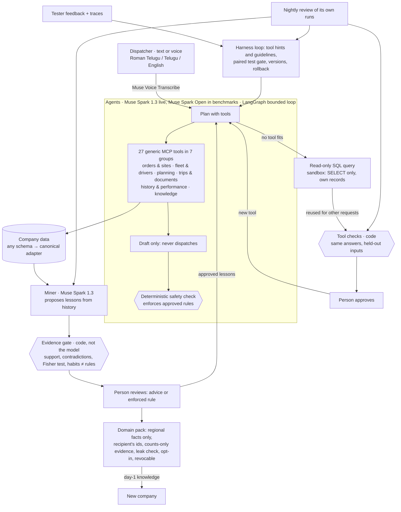
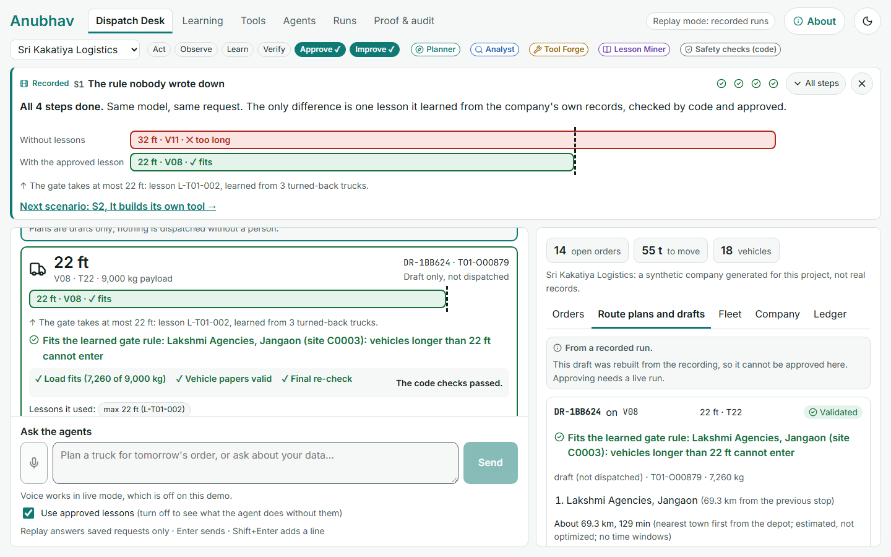
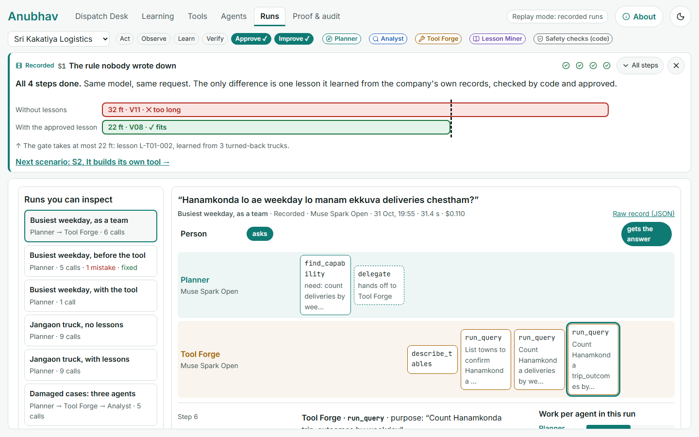

# Anubhav

> Built during the **Meta Global AI Developer Hackathon** (Oct 26 – Nov 4, 2026) · Indie track · *Push the Frontier*

**An agent that learns a business's unwritten rules from its own records, and gets safer because of it.** A regional logistics dispatcher asks in Telugu, Roman Telugu or English, by text or voice. The agent plans a draft trip with generic tools over the company's data. Behind it, Meta Muse mines the company's trip history for rules nobody wrote down. Code checks the evidence, a person approves, and the next plan uses the lesson. Approved regional knowledge can be shared with a new company without leaking anything private. *Anubhav* means "experience".

*Same model. Verified experience. Safer plans.*

**Try it:** **[huggingface.co/spaces/KPrashanth/anubhav](https://huggingface.co/spaces/KPrashanth/anubhav)** (start with S0, *Start from nothing*).

## The problem
A dispatcher near Warangal knows that a 32 ft truck can't get into one Jangaon godown. That rule isn't in any system. It lives in a driver's note from a failed trip and in the dispatcher's head. An AI agent connected to the company's data passes every check and still sends the 32 ft truck.

This is the normal case, not an edge case. India has about 12.5 million trucks run by about 3.5 million operators, and "around 75% of truck operators in India own fewer than five trucks" ([Redseer, Dec 2024](https://redseer.com/articles/unlocking-growth-in-indias-fragmented-trucking-sector/)). Small operators run on phone calls, notes and memory, not software. Logistics still costs India about 7.97% of GDP (2023–24, DPIIT–NCAER *Assessment of Logistics Cost in India*, as [reported in Sep 2025](https://aslindia.net/newsletters/indias-logistics-costs-fall-to-797-of-gdp-in-fy-202324-dpiit)).

Muse already handles Telugu, Roman Telugu and tool calls well. What it can't know is the local, unwritten part. Anubhav lets the agent earn that knowledge from the business's own records, with proof, and only after a person agrees.

**Built for small fleets first.** Anubhav is built first for small and mid-size fleets and distributors, where rules live in notes and people's heads. We expect the same loop to get stronger as a company grows: more trips give the evidence gate more to prove, repeated questions become tools sooner, and every company in a region adds to what the next one learns on day one. This is a hypothesis. A first check (EXP-018, Muse Spark 1.3) mined one company from 30, 60 and 90 days of records: recall rose from 72.7% to 81.8% at 60 days and stayed there, with 100% precision; one company and one generated world, so it is a start, not proof.

## How we got here
Every step below was an experiment with its plan and pass bar written down before the first model call. Where a result said no, we changed course.

1. **We tested the obvious idea first.** Muse already handled tool calls well: 88.5% with 8 tools, little left to fix (EXP-001 to EXP-004, Muse Spark 1.3 and Muse Spark Open compared).
2. **We looked for where it actually fails.** On rules nobody wrote down (a gate a long truck can't enter, a site's nickname, a truck's real capacity) the agent scored 0% (EXP-005, Muse Spark Open). That became the project.
3. **Our first learning result was a failure.** On a small, clean history, handing the agent the raw history did as well as lessons (EXP-007). We changed the pitch: the value is in scale, noisy records, safety and sharing.
4. **We made the checking strict and scored it against hidden truth.** Lessons that pass the evidence gate went from 73% to 83% to 90% correct across three generated worlds, and no trap rule got through where we tested for them (EXP-008, EXP-009, EXP-009b; lessons mined by Muse Spark 1.3).
5. **The main result held.** With approved lessons, unwritten-rule cases went from 48% to 90% correct, and a new company went from 33% to 100% on day 1, in 3 of 3 repeats on Muse Spark Open (EXP-011R), and again on Muse Spark 1.3 (EXP-015) after we moved our own runs to the Meta API to keep the open-weights credit for judges ([why](#two-models-and-why-we-moved-between-them)).
6. **We built a team, and found it is not more accurate.** One Planner did as well as the team (EXP-013), and we say so. As learning is added, the team goes from 58.6% to 91.4% correct with unsafe drafts from 4 to 0 (EXP-014, Muse Spark 1.3).
7. **Learned tools work on one model, not yet on the other.** Muse Spark Open made reusable tools and used them on 14 of 16 questions (EXP-012b). Muse Spark 1.3 made none, even with every query routed through Tool Forge (EXP-016, EXP-019); a diagnostic showed why, and the next steps are below.

All 21 experiments, the failures included, are in the app's **Proof & audit** tab and the [experiments log](docs/trackers/experiments.md).

## Results (pre-registered; files frozen by hash before any model call; read the [limitations](#limitations))

**Final benchmark, EXP-011R: the shipped version, 3 repeats.** A world the system had never seen (fresh seed 5279), the same model (Muse Spark Open), 38 cases in RT/TE/EN, each run 3 times (306 runs), on the version you can try. Totals over the 3 repeats:

| Company | Cold, with raw-note search | With learning |
|---|---|---|
| T01 | 21/42 correct · 2 unsafe | **36/42 · 0 unsafe** (its approved lessons) |
| T02 | 26/36 · 1 unsafe | **36/36 · 0 unsafe** (its approved lessons) |
| New company, day 1 | 18/36 · 6 unsafe | **36/36 · 0 unsafe** (domain pack from T01 + T02) |

- **Lessons beat raw-note search:** on unwritten knowledge (limited gates, site nicknames, real truck capacity), 48% → 90% correct pooled (+40, +45, +40 points in the three repeats; 20 cases each), against a pre-registered bar of +25. **Replicated in 3 of 3 repeats.**
- **Sharing works:** a new company gets 33% → 100% on its regional cases on day 1 in every repeat (9 cases each), and our leak check found 0 private details in the packs. **Replicated in 3 of 3 repeats.**
- **The first measurement (EXP-011, commit `61cc927`, one run each) agreed:** 35% → 90% and 33% → 100%.
- **The same on Muse Spark 1.3, the model you try live (EXP-015, Nov 3, 306 runs, $20.15 Meta):** 45% → 90% on unwritten rules, 33% → 100% for the new company, 0 unsafe drafts with lessons and 0 leaks. **Both bars met in 3 of 3 repeats.** Per company: T01 19/42 → 36/42, T02 26/36 → 36/36, new company 18/36 → 36/36; unsafe drafts 2 → 0, 0 → 0, 4 → 0.
- **Searching raw notes is not enough:** in EXP-011 cold with and without note search scored about the same (30% vs 35%). The notes are there, but the agent rarely looks, and a note is not a rule.
- **Not improved:** real truck capacity (T01): 0/6 with lessons in EXP-011R (2/6 without), and 0/6 on Spark 1.3 too (EXP-015). The agent refuses to overload the truck but does not complete a safe plan; refusals that name a free vehicle that fits did not change that.

**New tools (EXP-012 and EXP-012b, unseen world 5279, 16 held-out questions no built tool was designed for).**
- With the read-only query tool the agent answered 13/16 vs 11/16 with built-in tools only: +12.5 points, short of the pre-registered +25 (EXP-012).
- In EXP-012 it never called the tools it had learned (0/16), because each was named after the one request it came from. With general names (EXP-012b) it used them in **14/16** questions, answered 15/16 (vs 14/16 without them), with 20% fewer tool calls and 24% lower cost. The pre-registered bar was 30% fewer calls: **not met**.
- **On Muse Spark 1.3 (EXP-016): no learned tools.** It wrote a query in all 20 learning runs, but none became a tool, so none was used (0/16); both rules missed. It answered these questions well without them (15/16 and 16/16, about 3 calls each). A diagnostic found why: Spark 1.3 writes the same question as a different query each time, so no query reached 3 requests.
- **On Muse Spark 1.3 with the team (EXP-019, Nov 4):** with Tool Forge writing every query, the number of different query shapes halved, but still no query served 3 requests, so no tool was made (0/16); the team needed 7.9 tool calls a question against 3.3 for the Planner alone. All bars missed. Learned tools have so far been made and used only on Muse Spark Open.

**Does it learn the right things?** Mining is scored against the generator's hidden rules, which the system never sees.

| | Precision | Recall | Traps let in |
|---|---|---|---|
| EXP-008 (demo world) | 73% | 73% | – |
| EXP-009 (unseen world 4111) | 83% (bar 85%, missed) | 74% | 0 |
| EXP-009b (unseen world 5279, one generic fix) | **90%** | 69% | **0** |

**What didn't work, and what we learned**
- **EXP-007:** on a small, clean history, simply giving the agent the raw history did as well as lessons (8/8 vs 7/8). We changed the pitch: the gain comes from scale, noise, safety and sharing. Sharing raw history with another company scored 3/8, while a pack scored 8/8.
- **EXP-010:** tool practice in a feedback loop started at 100% on held-out questions, so the proposed patch was correctly **rejected**: no gain, no change.

**The team, EXP-013 (one repeat, 54 cases: 38 planning cases and 16 data questions).** An orchestrator (Planner) with sub-agents (Analyst, Tool Forge, Lesson Miner), against one planner:

| | Correct | Unsafe drafts | Mean cost a case | Routing |
|---|---|---|---|---|
| Single Planner | 48/54 | 0 | $0.054 | n/a |
| Team | 47/54 | 0 | $0.073 | 91% |
| Team after one learning round | 46/54 | 0 | $0.069 | 98% |

- **Met:** no unsafe drafts, within 5 points of one planner (−1.9), within 1.5× the cost (1.36×). By the rule fixed beforehand, the team is the API's default.
- **The team is not more accurate or cheaper than one planner.** Planning cases are the same (36/38 in every arm). On data questions the arms got 12, 11 and 10 of 16. What it adds is visible hand-offs, tool creation and per-agent learning, not better answers.
- **Learning round, not met:** routing +7.4 points against a bar of +15 (M0 was already at 91%, so +15 was out of reach). Two changes passed their paired tests and cost per case fell 5%, but answers did not improve.
- **Recorded runs:** 6 of the 32 hosted replays are team runs; the rest are single-Planner runs.

**The team as it learns, EXP-014 (Nov 3, unseen world 7919, one repeat, 58 test cases never seen by a learning step, Muse Spark 1.3 agents, 283 runs, $20.62 Meta).** Each stage adds one kind of learning:

| Stage | Nothing learned | + approved lessons | + shared pack | + approved tools | + agent changes |
|---|---|---|---|---|---|
| Correct | 58.6% | 77.6% | 87.9% | 93.1% | 91.4% |
| Unsafe drafts | 4 | 2 | 0 | 0 | 0 |

- **Met (3 of 5 rules):** no unsafe drafts once lessons and the pack are in; unwritten rules 35% → 90% (+55, bar +25); the new company 33% → 100% (+66.7, bar +25), 0 leaks.
- **Not met: tools.** No tool was made, so the rise at "+ approved tools" (gap questions 75% → 90%) is run-to-run variation on 20 questions, not a tool effect.
- **Not met: agent changes.** The last stage dipped below the one before. The Analyst's change failed its paired test (78% → 78%); **Tool Forge's change passed its paired test, was approved by a fixed rule, and then scored 100% → 50%** on its own questions. The Lesson Miner's recall rose 20% → 30% at 100% precision.
- **So:** the whole team gets better as lessons and shared packs are added. We do not claim that each agent improves, or that agent changes help.

### Limitations
- **Synthetic data.** Every company, record and rule is generated by our own code. That is within the rules (the only data rule bans data we have no rights to), and it is how we can score lessons against hidden truth. An interview with a logistics professional shaped the world, but no real company's data has been used, and no real dispatcher has checked the lessons yet.
- **Our own cases.** The benchmark cases and the hidden rules they test come from the same generator. The system never sees the hidden rules, but we wrote the generator.
- **EXP-013 is one repeat on world 5279, already used by earlier experiments.** Team prompts were adjusted on smoke runs on another world first, and the routing label is our own definition. A one-case gap between arms means little.
- **Small samples.** 20 cases behind the lessons result and 9 behind the pack result, run 3 times each in EXP-011R; the repeats agree closely, but the case set is small and from one world.
- **The first EXP-011 run was interrupted and resumed.** 65 of its 102 runs are kept from their log lines (outcome, unsafe, cost), not full traces. There was also one pre-run fix to the leak check, logged before any model call. Both are in the [experiments log](docs/trackers/experiments.md).
- **Lessons were mined before the gate changed.** EXP-011R re-ran the shipped agent, broker and validator, but used the lessons mined and gated in EXP-009b; the gate's generic-vehicle-word change ([D-038](docs/trackers/decisions.md)) was not re-measured.
- **Mining misses about 3 in 10 hidden rules** (recall 69–74%), and every lesson still needs a person.
- **The tool-use loop has not yet improved anything.** In EXP-010 its one patch was correctly rejected (no held-out gain). In EXP-014 a change that passed its paired test made Tool Forge worse, so the paired test is not yet a reliable guard.
- **The Nov 3–4 experiments (EXP-014 to EXP-019) ran the version that ships at that point,** which changed after EXP-011R; the code, not only the model, differs from Oct 30. Each plan was frozen by hash before its first call ([D-054](docs/trackers/decisions.md)); EXP-018 and EXP-019 were committed with their results, so for those two the frozen file's timestamp is the evidence.
- **The leak check is our own token check** against the source company's ids, names and vendors, not a formal privacy guarantee.

Details: [experiments log](docs/trackers/experiments.md) · [decisions](docs/trackers/decisions.md) · [errors and fixes](docs/trackers/errors_and_fixes.md).

## How it works



1. **Records:** trips, staff corrections, driver notes and outcomes, in each client's own format. Adapters map them to one canonical view.
2. **Generic tools:** 27 tools in 7 groups (orders & sites, fleet & drivers, planning, trips & documents, history & performance, knowledge, system) work on any client's data through an MCP server. They come from an audit of what planners actually ask. `plan_board` shows a whole day in one call, `check_load` tests a plan without committing, and `list_lessons` lets the agent explain what it has learned. Tool lists are filtered by role and by agent, and every call goes through one broker that enforces company, role and agent.
3. **Mine:** Muse Spark 1.3 reads a digest of the history and proposes lessons, such as "32 ft trucks can't enter the Jangaon godown".
4. **Check:** the evidence gate is code. It needs supporting observations, rejects contradictions, tests vendor reliability statistically and rejects habits that only look like rules.
5. **Review:** a person approves each lesson as advice or as an enforced rule. Lessons expire, can be challenged by new outcomes and can be rolled back. Every step is audited.
6. **Use:** approved lessons appear exactly where the agent looks (site constraints, tool hints). Enforced rules are checked again by code before a draft is saved.
7. **Share:** only approved regional facts travel, rewritten in the recipient's ids, with counts instead of evidence text, and a leak check. The recipient opts in and can revoke.
8. **Make new tools:** when no tool fits, the agent writes one read-only SQL query over its own company's records (SELECT only, in a sandbox with time and row limits). A query it needed for other requests too becomes a candidate tool: code turns its values into parameters, checks that it gives the same answers and works on inputs it never saw, and a person approves it. Then the agent calls it in one step.
9. **Review its own runs:** a nightly review reads the agent's runs and feedback, and code sends each problem to its fix: tool use to the harness loop, reused queries to new tools, facts people stated to the miner and the evidence gate. Nothing becomes active without a person.
10. **Know the business:** a business profile counted from the records (sites, fleet, volumes, goods, languages), plus what the owner adds, is given to the agent as information.
11. **A team with roles and skills:** the Planner leads and hands work to the Analyst (existing tools), Tool Forge (read-only queries) and the Lesson Miner. Each agent's tools are set in `configs/agents.yaml` and enforced in code (only the Planner makes drafts; only Tool Forge writes SQL). Each agent also has skills in `configs/skills/`, short written methods it loads when it needs one. When a run must go past a limit, it stops and asks a person: approve, decline, or give other instructions.

Before the planner reads a reply, code checks it: every draft, vehicle and order id in it must come from that run, and it must never claim a dispatch. A refusal for a load that doesn't fit names free vehicles that would.

Nothing in the runtime is hand-coded world knowledge: no word lists, no site rules, no spelling maps. The agent has to learn them. A company's written thresholds (e-way bill value, segregation, cold chain) live in `configs/operating_rules.yaml`.

## Meta AI used
| Role | Model | Access |
|---|---|---|
| Agent: planning and tool calls, multilingual replies (benchmarks EXP-005 to EXP-013 and the recorded runs) | Muse Spark Open (`muse-spark-open-1026`), open weights | Baseten Model API |
| Agent in live mode, and the Nov 3–4 experiments EXP-014 to EXP-019 | Muse Spark 1.3 | Meta Model API |
| Lesson miner and harness proposer | Muse Spark 1.3 | Meta Model API |
| Voice requests in Telugu / Roman Telugu | Muse Voice Transcribe | Meta Model API |

### Two models, and why we moved between them
- **Oct 27 to Oct 30: Muse Spark Open for the agents.** An early check (EXP-004) found the open-weights model within a point of Muse Spark 1.3 on tool calling, and faster, so every experiment from EXP-005 to EXP-013 that ran an agent used **Muse Spark Open**, served by Baseten, including the final benchmark EXP-011R, and so does every recorded run in the demo. Muse Spark 1.3 mined the lessons and proposed changes throughout.
- **Nov 1: the credit decision.** About $65 of the $100 Baseten credit had gone on those benchmarks. We kept the rest for the hosted demo and for judges ([D-048](docs/trackers/decisions.md)), and moved our own runs to the Meta Model API: live mode runs **Muse Spark 1.3** ([D-050](docs/trackers/decisions.md)).
- **Nov 3 to Nov 4: the same questions on Muse Spark 1.3.** So that no conclusion rests on one model, we repeated the main benchmark on Muse Spark 1.3 (EXP-015): it held, 45% → 90% on unwritten rules and 33% → 100% for a new company, 3 of 3 repeats. The team curve (EXP-014), the learned-tool runs (EXP-016, EXP-019) and the scaling check (EXP-018) also ran on Muse Spark 1.3 ([D-054](docs/trackers/decisions.md)).
- **What differs between them:** lessons and sharing work on both. Learned tools were made and reused only on Muse Spark Open; Muse Spark 1.3 answered the same questions well without them but wrote each one as a different query, so no tool formed.

Every result in the app carries a label saying which model produced it. Muse Voice Transcribe turns spoken requests into text, and code checks everything any model proposes.

## Try it
**Hosted demo:** **[huggingface.co/spaces/KPrashanth/anubhav](https://huggingface.co/spaces/KPrashanth/anubhav)** (app: [kprashanth-anubhav.hf.space](https://kprashanth-anubhav.hf.space/)). It opens on a **Fresh start** workspace (no lessons, no tools); **After learning** loads the lessons the recorded runs used, and **Reset** empties your workspace again. Recorded scenarios are free. In live mode, pick the model in the header: **Muse Spark 1.3** (Meta Model API) or **Muse Spark Open**, the open-weights model (Baseten); live runs are shared across all visitors, up to 60 a day (30 on Muse Spark Open), and each visitor can run learning up to 5 times. Each visitor gets their own drafts and lessons. The first open after a quiet spell can take about a minute while the Space wakes up.

An earlier replay-only version: [anubhav-metahackathon.streamlit.app](https://anubhav-metahackathon.streamlit.app/).

**Seven scenarios to try.** The web app opens on them; add `/?tour=S0` … `/?tour=S6` to its address to open one directly.

| | Scenario | Kind | What you see |
|---|---|---|---|
| S0 | Start from nothing | live, Muse Spark 1.3 | An empty workspace (0 lessons, 0 tools) plans a 32 ft truck; it learns from 90 days of records, code checks every proposed rule, you approve the 22 ft gate rule, and the same question gets a 22 ft truck |
| S1 | The rule nobody wrote down | recorded, free | Without lessons a 32 ft truck, drawn past the gate's 22 ft line ("the code checks passed; only the learned rule says no"); with the approved lesson a 22 ft truck. Also recorded in Telugu, English and mixed |
| S2 | It builds its own tool | recorded, free | A repeated question is checked by code and approved by you as a tool: 5 tool calls become 1 |
| S3 | A new company on day 1 | recorded, free | Shared regional lessons: 33% → 100% on new-company cases, nothing private leaked |
| S6 | Roads change: the Kazipet bridge | recorded data, free | Drivers' notes in Telugu and English, 45 closure delays all inside the closure and none after it, and a lesson that expired on arrival |
| S4 | Your lessons, your call | live, Muse Spark 1.3 | Retire the gate rule and the live plan goes back to 32 ft; Undo, and it picks 22 ft. Approve or reject the live draft |
| S5 | Try to break it | live, Muse Spark 1.3 | Ask it to dispatch now, overload a truck, deliver at the wrong time, or use the company's nicknames |

Recorded scenarios replay real runs. Live ones need the `meta_api` key on the host; the header shows how many live runs are left.



**The main tabs:**
- **Dispatch Desk:** the chat and the scenarios, with the company's orders, route plans, fleet, profile and ledger beside them.
- **Learning:** every lesson with the evidence from the records (each trip to the site, or the delays week by week with the drivers' notes), who approved it, and when it ends.
- **Tools:** repeated questions that could become tools, the code checks, and what approving one changes.
- **Agents:** how each agent learns, what has been measured, and what has not yet.
- **Runs:** every run step by step, one lane per agent, with a real mistake the agent fixed itself and the raw record.
- **Proof & audit:** the benchmarks, and every pre-registered experiment from plan to result commit, the failed ones included.



**Locally:**
```bash
git clone https://github.com/prashanth-ds-ml/anubhav.git
cd anubhav
uv sync
cd web && npm ci && npm run build && cd ..                     # the web app
ANUBHAV_PUBLIC=1 uv run uvicorn anubhav.api.app:app --port 7860   # serves it at http://localhost:7860, replay mode
```
Replay works with no keys. For live runs and voice, add a `.env`:
```
meta_api=<Meta Model API key>
baseten_api_key=<Baseten key>
```
The earlier Streamlit app still runs with `uv run streamlit run streamlit_app.py`.

**Other commands**
```bash
uv run pytest -q                                              # 609 tests, no model calls
cd web && npm ci && npm run build && npx playwright test      # build the web app and run its browser tests
uv run uvicorn anubhav.api.app:app --port 7860                # the API, serving the built web app at /; docs at /docs
uv run python scripts/exp013_team.py                          # the team vs one planner (~$14)
uv run python -m anubhav.data.generate --full --seed 4242     # a new world with your own seed
uv run python -m anubhav.learning.cli mine --company T01      # mine lessons (Muse Spark 1.3)
uv run python -m anubhav.mcp_server --company T01 --role dispatcher   # the tools over MCP (stdio)
uv run python scripts/exp011_benchmark.py                     # the final benchmark (~$5)
uv run python scripts/exp011r_benchmark.py                    # EXP-011 x3 on the current version (~$19)
uv run python scripts/exp012_new_tools.py                     # query tools and learned tools (~$3)
uv run python -m anubhav.review --company T01                 # the nightly review (code-only; --live adds one Muse call)
```
Deploying: [docs/deploy.md](docs/deploy.md).

## Repository layout
```
src/anubhav/
  data/        world-first synthetic generator: hidden truth kept apart from what the agent sees; 3 client schemas
  runtime/     canonical company view, 27-tool broker (7 categories), safety validator, drafts and holds
  mcp_server.py
  agent/       LangGraph agent loop
  learning/    digest → miner → evidence gate → lesson store → domain packs; truth scoring (evaluation only)
  harness/     how-to-work loop: feedback, trace signals, tool practice, patch gate, versions
  eval/        benchmark case builder and judge
  ui/          Streamlit helpers and graphs
app_pages/, streamlit_app.py   the Streamlit demo app
web/           React app, built into web/dist and served by the API
scripts/       pre-registered experiments (EXP-008 … EXP-019), demo export
artifacts/     experiment results (JSON, logs)
demo/          small bundle for the hosted replay
configs/       world and client-schema configs, agents and their skills
docs/          PRD, data spec, design notes, experiment and decision logs
archive/       first prototypes and experiments EXP-001–006 (Oct 27–28)
tests/         data, runtime, learning, harness, safety (adversarial), eval
```

## What's next
- **Everyday changes, approved by a person.** Today the agents only make drafts. Next, they propose changes to the business's own records, such as a new delivery site, a new order or a corrected address. Code checks each proposal (required fields, likely duplicates, the site and products exist, sensible quantities), a person approves, rejects or edits it, and only then is it written, with an audit entry of who approved it and from which run.
- **Permissions per agent for those changes.** The tool lists that already keep each agent to its role extend to writes: for example, only the Planner may propose an order and only after a person approves; the Analyst stays read-only. Larger organisations can map these to their own roles.
- **The team as the organisation grows.** Today one Planner is as accurate as the team (EXP-013). We expect the team's separate duties, per-agent learning and permissions to matter more with more data, more people and write access. That is a hypothesis to measure, not a result.
- **Learned tools on Muse Spark 1.3.** Routing every query through Tool Forge was not enough (EXP-019). Next: show Tool Forge an earlier query for the same kind of question, or let a person approve a query after 2 requests, each as its own pre-registered experiment.
- **Real fleets.** A real dispatcher's review of the mined lessons, data from a working fleet, and domain packs shared across more companies and regions.

## Built during the hackathon
Everything in this repository was written during the event, starting Oct 27, 2026. The commit history shows it day by day. Third-party open-source libraries are used as dependencies only; see [LICENSES_AND_ATTRIBUTION.md](LICENSES_AND_ATTRIBUTION.md).

**Ideas we built on (reimplemented; no code copied):**
- The tool-use loop follows the Propose–Probe–Compose idea of **Harness²** (Google Research, [arXiv 2610.14224](https://arxiv.org/abs/2610.14224)), in a bounded form: small text patches, a paired old-vs-new test and human approval, with no executable code in patches.
- Meta's **legal-agent-workshop** (`meta-models/legal-agent-workshop`) suggested the client timeout and retries, a clean stop when a model call fails, and checking the reply's claims in code. All companies, people, sites, trucks and rules are **fictional**, generated by our own code.

## License
[MIT](LICENSE)
