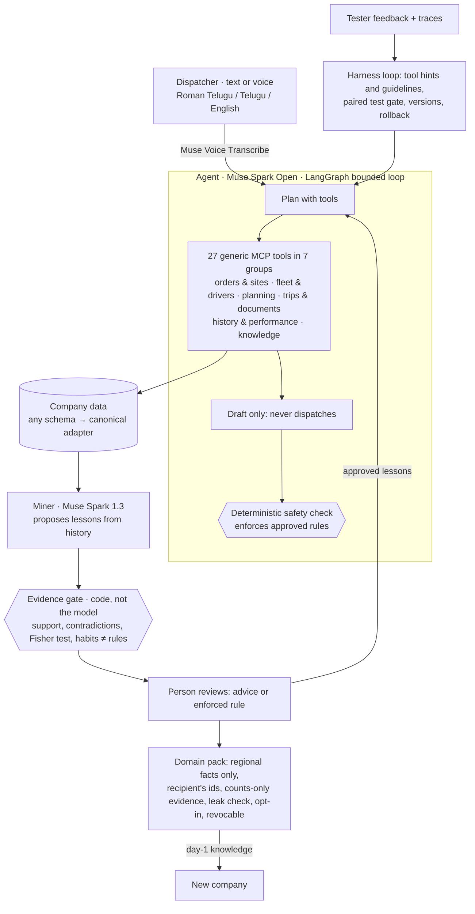

# Anubhav

> Built during the **Meta Global AI Developer Hackathon** (Oct 26 – Nov 4, 2026) · Indie track · *Push the Frontier*

**An agent that learns a business's unwritten rules from its own records, and gets safer because of it.** A regional logistics dispatcher asks in Telugu, Roman Telugu or English, by text or voice. The agent plans a draft trip with generic tools over the company's data. Behind it, Meta Muse mines the company's trip history for rules nobody wrote down. Code checks the evidence, a person approves, and the next plan uses the lesson. Approved regional knowledge can be shared with a new company without leaking anything private. *Anubhav* means "experience".

*Same model. Verified experience. Safer plans.*

## The problem
A dispatcher near Warangal knows that a 32 ft truck can't get into one Jangaon godown. That rule isn't in any system. It lives in a driver's note from a failed trip and in the dispatcher's head. An AI agent connected to the company's data passes every check and still sends the 32 ft truck.

This is the normal case, not an edge case. India has about 12.5 million trucks run by about 3.5 million operators, and "around 75% of truck operators in India own fewer than five trucks" ([Redseer, Dec 2024](https://redseer.com/articles/unlocking-growth-in-indias-fragmented-trucking-sector/)). Small operators run on phone calls, notes and memory, not software. Logistics still costs India about 7.97% of GDP (2023–24, DPIIT–NCAER *Assessment of Logistics Cost in India*, as [reported in Sep 2025](https://aslindia.net/newsletters/indias-logistics-costs-fall-to-797-of-gdp-in-fy-202324-dpiit)).

Muse already handles Telugu, Roman Telugu and tool calls well. What it can't know is the local, unwritten part. Anubhav lets the agent earn that knowledge from the business's own records, with proof, and only after a person agrees.

## Results (pre-registered; files frozen by hash before any model call; read the [limitations](#limitations))

**Final benchmark, EXP-011.** It runs on a world the system had never seen (fresh seed 5279), with the same model (Muse Spark Open) and the same 38 cases in RT/TE/EN, **one run each**, using the 19 tools that existed then (commit `61cc927`).

| Company | Cold, with raw-note search | With learning |
|---|---|---|
| T01 | 7/14 correct · 0 unsafe | **12/14 · 0 unsafe** (its approved lessons) |
| T02 | 5/12 · 1 unsafe | **12/12 · 0 unsafe** (its approved lessons) |
| New company, day 1 | 6/12 · 2 unsafe | **12/12 · 0 unsafe** (domain pack from T01 + T02) |

- **Lessons beat raw-note search:** on unwritten knowledge (limited gates, site nicknames, real truck capacity), 35% → 90% correct (7/20 → 18/20 cases, T01 + T02), against a bar of +25 points.
- **Sharing works:** a new company gets 33% → 100% on its regional cases on day 1 (3/9 → 9/9), and our leak check found 0 private details in the pack.
- **Searching raw notes is not enough:** cold with and without note search scored about the same (30% vs 35%). The notes are there, but the agent rarely looks, and a note is not a rule.
- **Not improved:** real truck capacity. The agent refused to overload the truck but didn't suggest another one.

**Does it learn the right things?** Mining is scored against the generator's hidden rules, which the system never sees.

| | Precision | Recall | Traps let in |
|---|---|---|---|
| EXP-008 (demo world) | 73% | 73% | – |
| EXP-009 (unseen world 4111) | 83% (bar 85%, missed) | 74% | 0 |
| EXP-009b (unseen world 5279, one generic fix) | **90%** | 69% | **0** |

**What didn't work, and what we learned**
- **EXP-007:** on a small, clean history, simply giving the agent the raw history did as well as lessons (8/8 vs 7/8). We changed the pitch: the gain comes from scale, noise, safety and sharing. Sharing raw history with another company scored 3/8, while a pack scored 8/8.
- **EXP-010:** tool practice in a feedback loop started at 100% on held-out questions, so the proposed patch was correctly **rejected**: no gain, no change.

### Limitations
- **Synthetic data.** Every company, record and rule is generated by our own code. That is within the rules (the only data rule bans data we have no rights to), and it is how we can score lessons against hidden truth. An interview with a logistics professional shaped the world, but no real company's data has been used, and no real dispatcher has checked the lessons yet.
- **Our own cases.** The benchmark cases and the hidden rules they test come from the same generator. The system never sees the hidden rules, but we wrote the generator.
- **Small samples, one run each.** 20 cases behind 35% → 90%, 9 behind 33% → 100%, one run per case, so there is no spread yet.
- **The EXP-011 run was interrupted and resumed.** 65 of its 102 runs are kept from their log lines (outcome, unsafe, cost), not full traces. There was also one pre-run fix to the leak check, logged before any model call. Both are in the [experiments log](docs/trackers/experiments.md).
- **The app is newer than the measurement.** After EXP-011 we changed the agent prompt, the gate's generic vehicle words, the broker's errors (refusals now name the next step), and added the reply check and the business profile ([D-038](docs/trackers/decisions.md)). The numbers above are for commit `61cc927` and have not been re-measured on the current version.
- **Mining misses about 3 in 10 hidden rules** (recall 69–74%), and every lesson still needs a person.
- **The tool-use loop has not yet improved anything.** In EXP-010 its one patch was correctly rejected (no held-out gain).
- **The leak check is our own token check** against the source company's ids, names and vendors, not a formal privacy guarantee.

Details: [experiments log](docs/trackers/experiments.md) · [decisions](docs/trackers/decisions.md) · [errors and fixes](docs/trackers/errors_and_fixes.md).

## How it works



1. **Records:** trips, staff corrections, driver notes and outcomes, in each client's own format. Adapters map them to one canonical view.
2. **Generic tools:** 27 tools in 7 groups (orders & sites, fleet & drivers, planning, trips & documents, history & performance, knowledge, system) work on any client's data through an MCP server. They come from an audit of what planners actually ask. `plan_board` shows a whole day in one call, `check_load` tests a plan without committing, and `list_lessons` lets the agent explain what it has learned. Tool lists are filtered by role, and every call goes through one broker that enforces company and role.
3. **Mine:** Muse Spark 1.3 reads a digest of the history and proposes lessons, such as "32 ft trucks can't enter the Jangaon godown".
4. **Check:** the evidence gate is code. It needs supporting observations, rejects contradictions, tests vendor reliability statistically and rejects habits that only look like rules.
5. **Review:** a person approves each lesson as advice or as an enforced rule. Lessons expire, can be challenged by new outcomes and can be rolled back. Every step is audited.
6. **Use:** approved lessons appear exactly where the agent looks (site constraints, tool hints). Enforced rules are checked again by code before a draft is saved.
7. **Share:** only approved regional facts travel, rewritten in the recipient's ids, with counts instead of evidence text, and a leak check. The recipient opts in and can revoke.

Before the planner reads a reply, code checks it: every draft, vehicle and order id in it must come from that run, and it must never claim a dispatch. A refusal for a load that doesn't fit names free vehicles that would.

Nothing in the runtime is hand-coded world knowledge: no word lists, no site rules, no spelling maps. The agent has to learn them. A company's written thresholds (e-way bill value, segregation, cold chain) live in `configs/operating_rules.yaml`.

## Meta AI used
| Role | Model | Access |
|---|---|---|
| Agent: planning and tool calls, multilingual replies | Muse Spark Open (`muse-spark-open-1026`) | Baseten Model API |
| Lesson miner and harness proposer | Muse Spark 1.3 | Meta Model API |
| Voice requests in Telugu / Roman Telugu | Muse Voice Transcribe | Meta Model API |

**Open weights end to end:** every agent run, the live demo and the whole EXP-011 benchmark run on **Muse Spark Open**, the open-weights model, served by Baseten. Muse Spark 1.3 (Meta Model API) only proposes lessons and patches, offline, and code checks everything it proposes; Muse Voice Transcribe turns speech into text.

## Try it
**Hosted demo:** **[anubhav-metahackathon.streamlit.app](https://anubhav-metahackathon.streamlit.app/)**. Replay mode, no keys, free; each visitor gets their own drafts and lessons. The first open after a quiet spell can take about a minute while it wakes up.

**Locally:**
```bash
git clone https://github.com/prashanth-ds-ml/anubhav.git
cd anubhav
uv sync
uv run streamlit run streamlit_app.py     # builds the demo world from its seed on first start
```
Replay works with no keys. For live runs and voice, add a `.env`:
```
meta_api=<Meta Model API key>
baseten_api_key=<Baseten key>
```

Things to try in the app:
- **Workbench:** pick a suggestion and compare *Use approved lessons* off vs on. Open **Show as a graph** to see which tools the agent used.
- **What it learned:** each lesson, its evidence, and how it was learned day by day.
- **Share:** publish a pack to the new company and see what arrives.
- **Business profile:** what the agent knows about the company, counted from its records, plus what the owner adds.
- **Logs:** every run as plan → act → observe → code checks, and every lesson, patch and piece of feedback on one timeline.
- **Proof & audit:** the benchmark and every traced run.

**Other commands**
```bash
uv run pytest -q                                              # 295 tests (167 Anubhav + 128 archived prototype), no model calls
uv run python -m anubhav.data.generate --full --seed 4242     # a new world with your own seed
uv run python -m anubhav.learning.cli mine --company T01      # mine lessons (Muse Spark 1.3)
uv run python -m anubhav.mcp_server --company T01 --role dispatcher   # the tools over MCP (stdio)
uv run python scripts/exp011_benchmark.py                     # the final benchmark (~$5)
```
Deploying: [docs/deploy.md](docs/deploy.md).

## Repository layout
```
src/anubhav/
  data/        world-first synthetic generator: hidden truth kept apart from what the agent sees; 3 client schemas
  runtime/     canonical company view, 27-tool broker (7 categories), safety validator, drafts and holds
  mcp_server.py
  agent/       LangGraph agent loop
  learning/    digest → miner → evidence gate → lesson store → domain packs; truth scoring (evaluation only)
  harness/     how-to-work loop: feedback, trace signals, tool practice, patch gate, versions
  eval/        benchmark case builder and judge
  ui/          Streamlit helpers and graphs
app_pages/, streamlit_app.py   the demo app
scripts/       pre-registered experiments (EXP-008 … EXP-011), demo export
artifacts/     experiment results (JSON, logs)
demo/          small bundle for the hosted replay
configs/       world and client-schema configs
docs/          PRD, data spec, blueprint, trackers (Obsidian vault)
archive/       first prototypes and experiments EXP-001–006 (Oct 27–28)
tests/         data, runtime, learning, harness, safety (adversarial), eval
```

## Built during the hackathon
Everything in this repository was written during the event, starting Oct 27, 2026. The commit history shows it day by day. Third-party open-source libraries are used as dependencies only; see [LICENSES_AND_ATTRIBUTION.md](LICENSES_AND_ATTRIBUTION.md).

**Ideas we built on (reimplemented; no code copied):**
- The tool-use loop follows the Propose–Probe–Compose idea of **Harness²** (Google Research, [arXiv 2610.14224](https://arxiv.org/abs/2610.14224)), in a bounded form: small text patches, a paired old-vs-new test and human approval, with no executable code in patches.
- Meta's **legal-agent-workshop** (`meta-models/legal-agent-workshop`) suggested the client timeout and retries, a clean stop when a model call fails, and checking the reply's claims in code. All companies, people, sites, trucks and rules are **fictional**, generated by our own code.

## License
[MIT](LICENSE)
