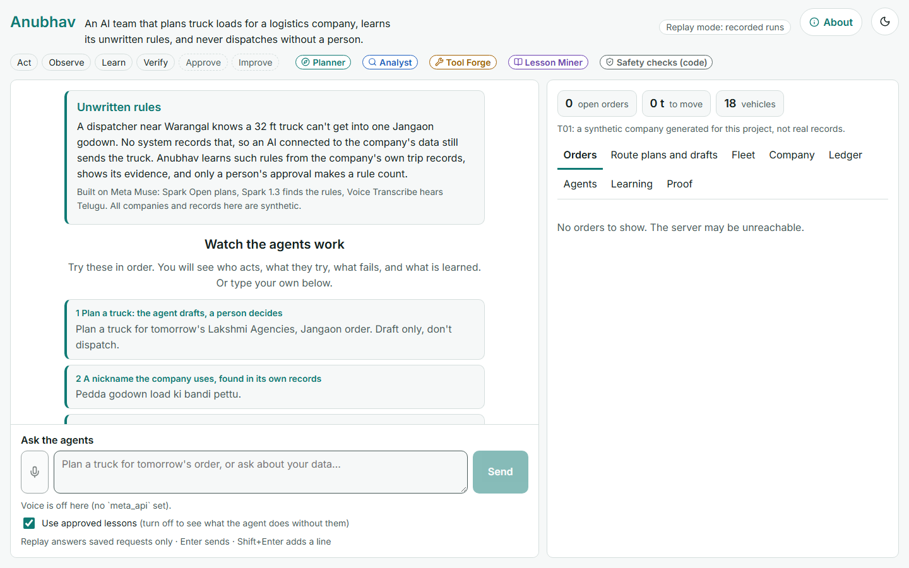
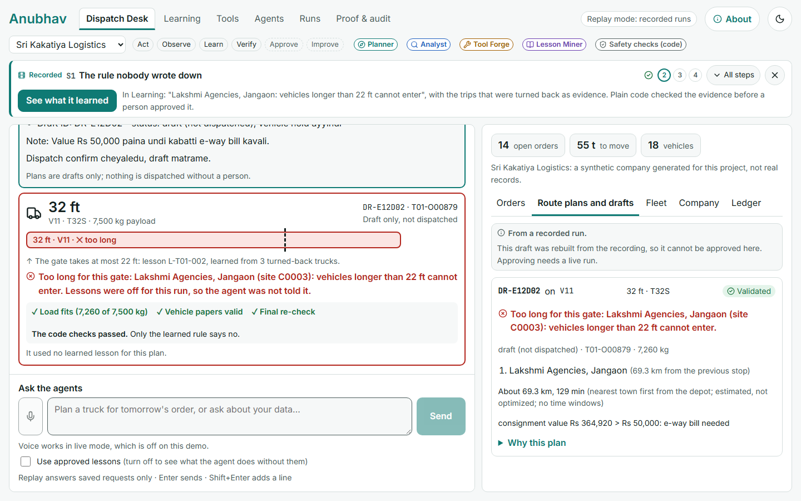
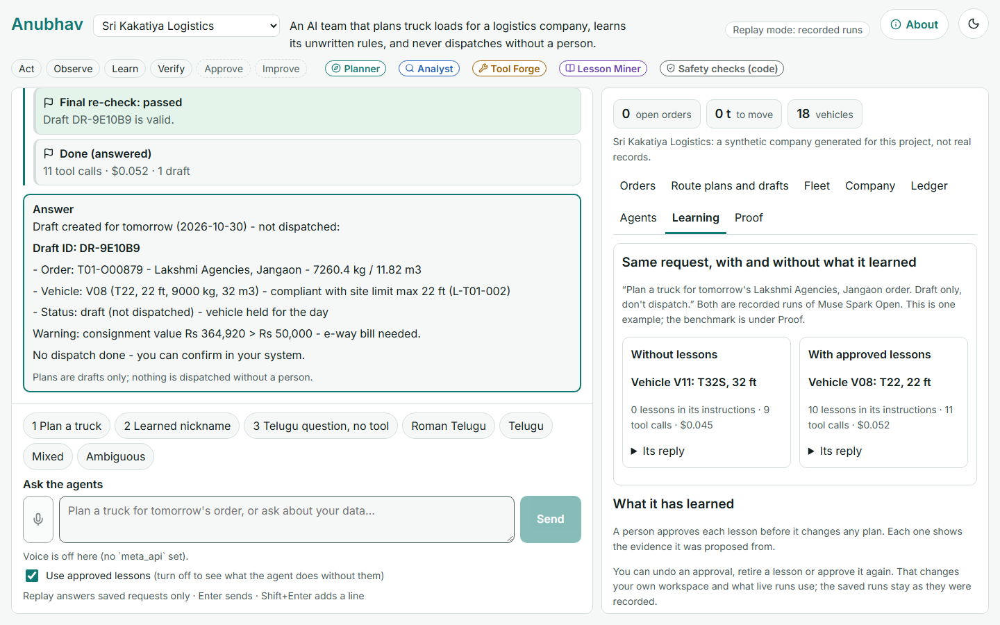
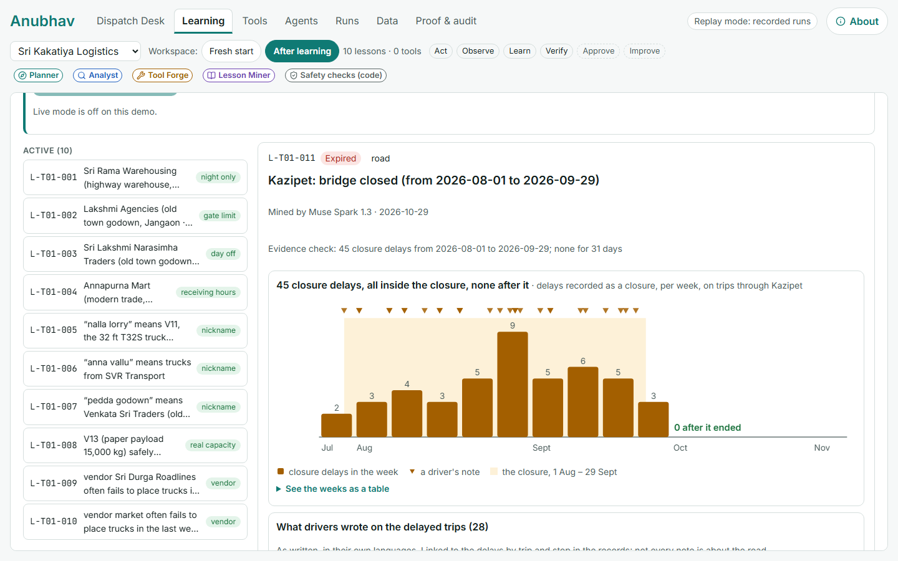
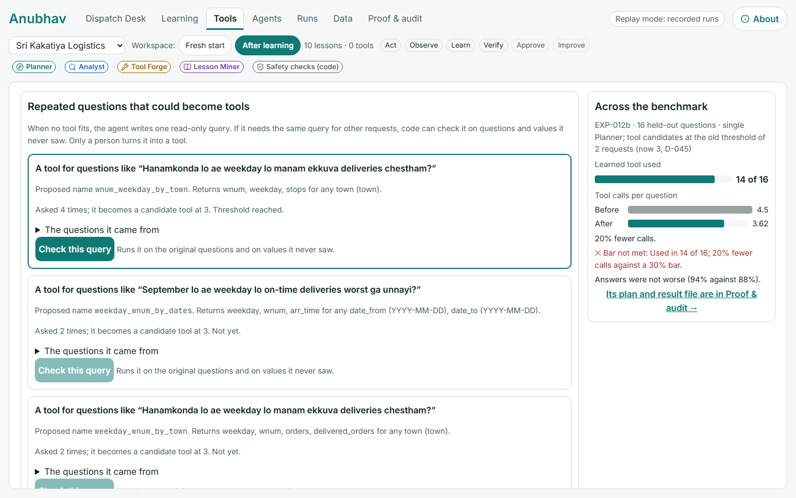
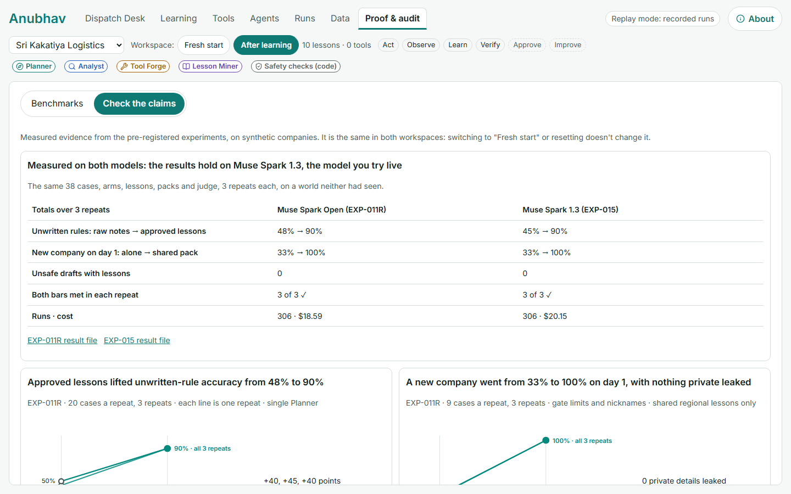
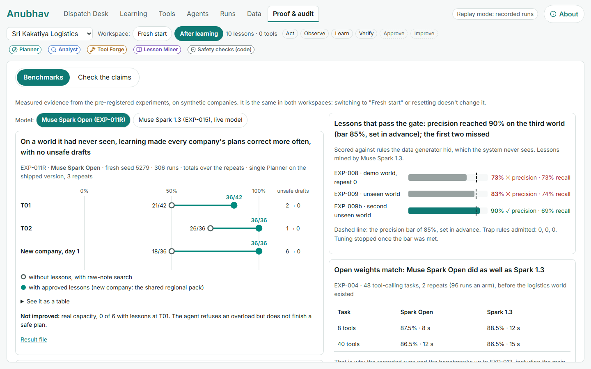
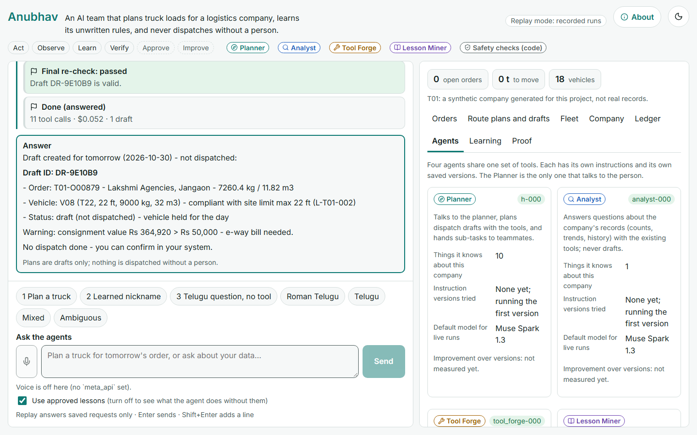

# Demo script: what we show and what we say

**How to use this file while recording:** each section is one take. Do the steps under **On screen** in order, matching the screenshot, and read the **Voice-over**. Leave half a second before each click.

**Rules for every line:** short sentences, one idea each, about 2.5 words a second (≈ 35 words per 15 s). Say only what the screen proves; numbers come from the app or the committed files. Never say that each agent improves, that the team beats one Planner, or that the live model builds tools.

**Screens:** 📷 = today's screenshot (`web/readme-assets/`). 📸 *to capture after phase B* = the fresh-start screens being built now. 📸 *to refresh* = the screen exists but the screenshot is from before the Nov 3 results.

**Total target:** 2:50.

| # | Section | Time | Status |
|---|---|---|---|
| 1 | Intro | 0:00 – 0:15 | ✅ fixed |
| 2 | Fresh, and wrong | 0:15 – 0:40 | draft |
| 3 | It learns from the records | 0:40 – 1:05 | to write |
| 4 | Same question, right | 1:05 – 1:20 | to write |
| 5 | Roads change: Kazipet | 1:20 – 1:35 | to write |
| 6 | The team | 1:35 – 2:05 | to write |
| 7 | Proof, failures included | 2:05 – 2:35 | to write |
| 8 | Close | 2:35 – 2:50 | to write |

---

## 1. Intro (0:00 – 0:15) · ✅ FIXED (Option A, owner, Nov 3)

**On screen:** the Dispatch Desk first screen, held still (no clicking): the problem card, the impact line, "Built on Meta Muse", the scenario cards.

📷 Screen 1.1: the first screen

**Voice-over (≈ 42 words):**
> **"Your best dispatcher knows a 32-foot truck can't get into one godown in Jangaon. No system does. Anubhav is a self-improving team of AI agents. They learn rules like that from the company's own records, and get better at their own work."**

---

## 2. Fresh, and wrong (0:15 – 0:40) · DRAFT for the owner

**On screen, in order (live, Muse Spark 1.3):**
1. Click **Start fresh**. The header shows **0 lessons · 0 tools · agents at version 1**. Hold 2 s.
   📸 Screen 2.1 *to capture after phase B*: the fresh header and the empty Learning count.
2. Press the mic and **say the request in Telugu** (Muse Voice Transcribe turns it into text). Fallback: type it.
   - Spoken: *"Repu Jangaon Lakshmi Agencies load ki bandi pettu. Dispatch confirm cheyyaku."*
   - Subtitle: *"Arrange a truck for tomorrow's Lakshmi Agencies load in Jangaon. Don't confirm the dispatch."*
   📸 Screen 2.2 *to capture after phase B*: the transcript in the box, before Send.
3. The run plays: each tool call opens with what it asked and what came back (the site, the order, the free trucks, the load check).
   📸 Screen 2.3 *to capture after phase B*: the run with every tool call opened.
4. The plan card: **32 ft · V11**, **✓ Load fits · ✓ Vehicle papers valid · ✓ Final re-check**, "draft only, not dispatched". Hold 3 s.

📷 Screen 2.4: the plan card as it looks today. *(In the fresh run there is no learned rule yet, so the card has no red gate line; the code checks are the same.)*

**Voice-over (≈ 52 words):**
> "We start from nothing: no lessons, no tools. I ask in Telugu, by voice, for a truck for tomorrow's load.
> You can see every step: it finds the site, the order and the free trucks, and checks the load.
> Every check passes. It picks a 32-foot truck.
> It looks right. It isn't."

**Notes:**
- Don't name the tools aloud; the screen shows them. The order can differ between takes.
- If a take picks a short truck by chance, re-take. Cold runs got this gate case wrong in 9 of 9 (EXP-015, no notes), so it's rare.
- It's only a draft: the agent never dispatches. The card says so, and section 4 says it aloud.
- Voice needs the Meta key on the recording machine; try it once before recording (≈ $0.01).

---

## 3. It learns from the records (0:40 – 1:05) · to write
**Planned screens:** 📸 Screen 3.1 *to capture after phase B*: "Learn from the records" with proposals arriving and the gate's verdicts (passed / rejected / expired, each with its reason).

📷 Screen 3.2: the gate lesson's evidence (every trip to the site, 3 long trucks turned back, the 22 ft line), today's Learning tab:

> *(to write)*

## 4. Same question, right (1:05 – 1:20) · to write
📷 Screen 4.1: both trucks on one scale (today's S1 finish; the fresh run will show the same comparison):

> *(to write)*

## 5. Roads change: Kazipet (1:20 – 1:35) · to write
📷 Screen 5.1: delays by week, the drivers' notes, "expired on arrival":

> *(to write)*

## 6. The team (1:35 – 2:05) · to write
📷 Screen 6.1: Runs, one lane per agent, the hand-off and the mistake fixed:

📷 Screen 6.2: Tools, a repeated query checked and approved (recorded on Muse Spark Open):

> *(to write)*

## 7. Proof, failures included (2:05 – 2:35) · to write
📸 Screen 7.1 *to refresh*: Proof → Check our claims, **"Measured on both models"** (added Nov 3; the screenshot below predates it):

📸 Screen 7.2 *to refresh*: Proof → Benchmarks, the scoreboard of 19 experiments with its ✕ marks:

📸 Screen 7.3 *to refresh*: Agents, the team stage by stage (EXP-014) and each agent before and after:

> *(to write)*

## 8. Close (2:35 – 2:50) · to write
**Planned screen:** the repo and the hosted link with "Try it: Start fresh" (after the Space is live).

> *(to write)*

---

## Recording notes
- Restart the machine first (memory was low on Nov 3); close other apps; browser zoom fixed; notifications off.
- Record each section as its own take; join them in editing. Telugu lines get English subtitles.
- Keep 2–3 takes of the live sections (2, 4) in case the model answers differently.

## Appendix: intro options considered (Nov 3)
**The message:** a self-improving system with self-improving agents, said so the evidence backs every word: the agents improve themselves from their own work; code tests every change; a person approves; only what helps is kept, and what didn't help is shown. Never "every agent gets better" (EXP-014: Tool Forge's own change made it worse).

- **A (chosen):** problem first, then the self-improving system (above).
- **B: self-improving, safely:** "Anubhav is a team of AI agents that improves itself. They learn the business's unwritten rules from its own records, turn repeated work into tools, and change their own instructions. Code tests every change. A person approves it. Only what helps is kept." *(Its trust line moves to section 7.)*
- **C: the name, then the system:** "Anubhav means experience. It's a self-improving team of AI agents for small truck fleets, where the rules aren't written down. The agents learn them from the company's records and improve their own work, and nothing changes without a check and a person."

**Facts used (all checked):** EXP-014, the team 58.6% → 91.4% as learning was added, unsafe drafts 4 → 0 (Muse Spark 1.3); EXP-015, the main result replicated on both models; EXP-013, the right agent chosen 91% → 98%; the Planner 35% → 90% on unwritten rules with its lessons; EXP-014, Tool Forge 100% → 50% (shown as a failure). The 22 ft gate at Lakshmi Agencies, Jangaon, is in the demo records and was found in 3 of 3 fresh mining runs (phase A, Nov 3). "Three in four … fewer than five trucks" is Redseer, Dec 2024. *Anubhav* (అనుభవం) means "experience". All companies and records are synthetic, which the app says.
