# Demo script: what we show and what we say

**How to use this file while recording:** each section is one take. Do the steps under **On screen** in order, matching the screenshot, and read the **Voice-over**. Leave half a second before each click.

**Rules for every line:** short sentences, one idea each, about 2.5 words a second (≈ 35 words per 15 s). Say only what the screen proves; numbers come from the app or the committed files. Never say that each agent improves, that the team beats one Planner, or that the live model builds tools.

**Screens:** 📷 = a screenshot in `docs/demo_screens/` (Nov 3: the live fresh run on Muse Spark 1.3, and the recorded pages). Re-take them with `web/scripts/demo-fresh-run.mjs` (live, ≈ $0.20) and `web/scripts/demo-proof-shots.mjs` (free). 📸 = still to capture.

**Total target:** 2:50.

| # | Section | Time | Status |
|---|---|---|---|
| 1 | Intro | 0:00 – 0:15 | ✅ fixed |
| 2 | Fresh, and wrong | 0:15 – 0:40 | draft |
| 3 | It learns from the records | 0:40 – 1:05 | draft |
| 4 | Same question, right | 1:05 – 1:20 | draft |
| 5 | Roads change: Kazipet | 1:20 – 1:35 | draft |
| 6 | The team | 1:35 – 2:05 | draft |
| 7 | Proof, failures included | 2:05 – 2:35 | draft |
| 8 | Close | 2:35 – 2:50 | draft |

---

## 1. Intro (0:00 – 0:15) · ✅ FIXED (Option A, owner, Nov 3)

**On screen:** the Dispatch Desk first screen, held still (no clicking): the problem card, the impact line, "Built on Meta Muse", the scenario cards.

📷 Screen 1.1: the first screen

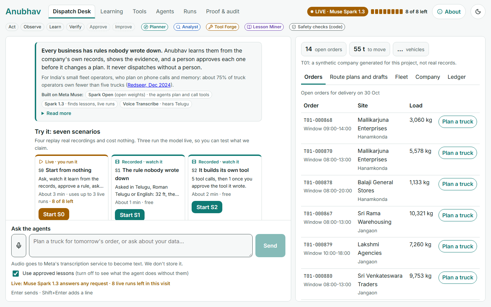

**Voice-over (≈ 42 words):**
> **"Your best dispatcher knows a 32-foot truck can't get into one godown in Jangaon. No system does. Anubhav is a self-improving team of AI agents. They learn rules like that from the company's own records, and get better at their own work."**

---

## 2. Fresh, and wrong (0:15 – 0:40) · DRAFT for the owner

**On screen, in order (live, Muse Spark 1.3; scenario S0 "Start from nothing"):**
1. Click **Start S0**, then **Start fresh**. The status shows **0 lessons · 0 tools · agents at version 1**. Hold 2 s.

   📷 Screen 2.1: started fresh

   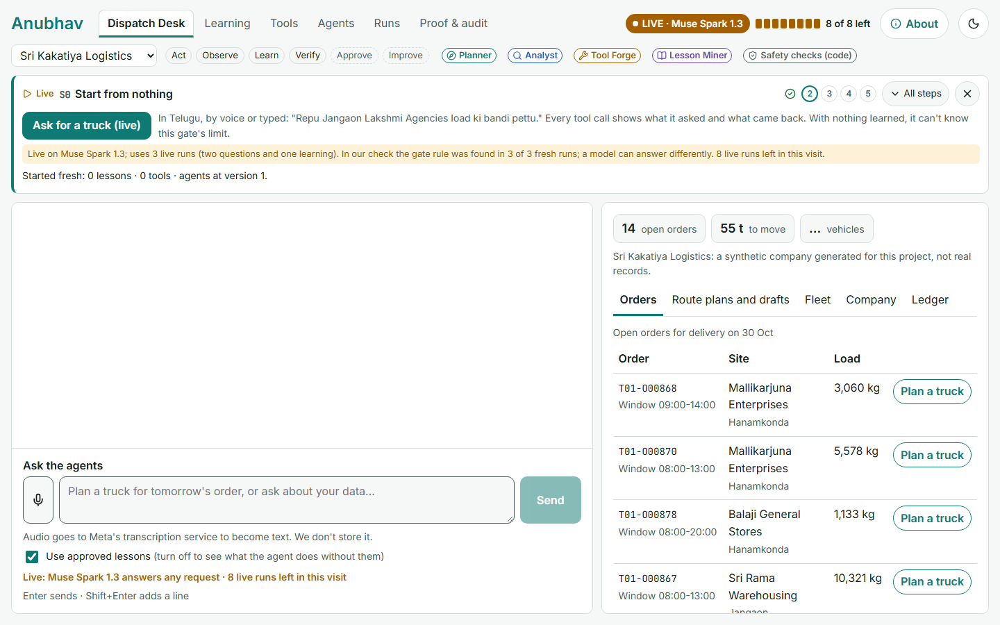
2. Press the mic and **say the request in Telugu** (Muse Voice Transcribe turns it into text). Fallback: press **Ask for a truck (live)**, which types the same line.
   - Spoken: *"Repu Jangaon Lakshmi Agencies load ki bandi pettu. Dispatch confirm cheyyaku."*
   - Subtitle: *"Arrange a truck for tomorrow's Lakshmi Agencies load in Jangaon. Don't confirm the dispatch."*
3. The run plays. Open **Show how it got there**: "0 approved lessons in its instructions", then each tool call with what it asked and what came back (`find_site` → Lakshmi Agencies, Jangaon; the open orders; the free trucks; the load check). Scroll slowly.

   📷 Screen 2.3: the run, every tool call readable

   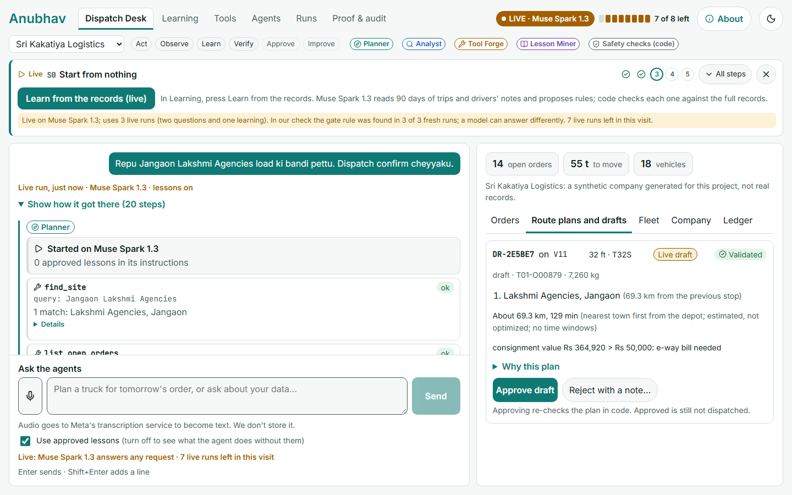
4. Scroll to the plan card: **V11, 32 ft**, **✓ Load fits · ✓ Vehicle papers valid · ✓ Final re-check**, "It used no learned lesson for this plan", "Live draft, not dispatched". Hold 3 s.

   📷 Screen 2.4: the plan card, 32 ft (the right panel shows "32 ft · T32S")

   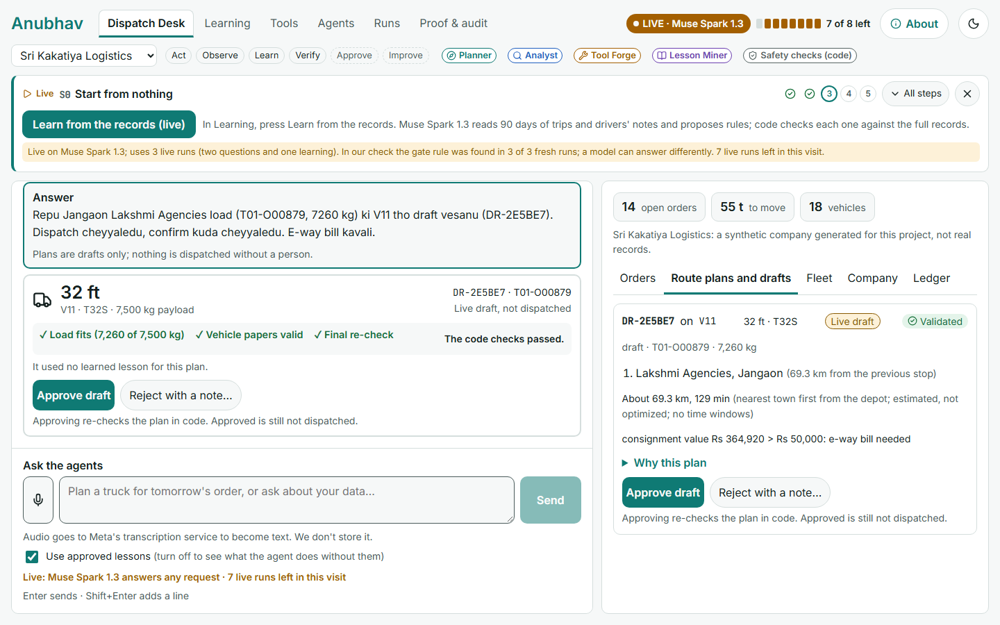

**Voice-over (≈ 52 words):**
> "We start from nothing: no lessons, no tools. I ask in Telugu, by voice, for a truck for tomorrow's load.
> You can see every step: it finds the site, the order and the free trucks, and checks the load.
> Every check passes. It picks a 32-foot truck.
> It looks right. It isn't."

**Notes:**
- Don't name the tools aloud; the screen shows them. The order can differ between takes.
- If a take picks a short truck by chance, re-take. Cold runs got this gate case wrong in 9 of 9 (EXP-015, no notes), so it's rare.
- Voice needs the Meta key on the recording machine; try it once before recording (≈ $0.01).

---

## 3. It learns from the records (0:40 – 1:05) · DRAFT for the owner

**On screen, in order (live):**
1. The guide's next step is **Learn from the records (live)**; press it. It opens Learning. Press **Learn from the records (live)** in the panel.
2. The stages tick one by one: **Read the records: 829 delivery stops on 606 trips, 198 drivers' notes (99 Roman Telugu, 86 Telugu, 13 English), 641 planner messages**, then "Muse Spark 1.3 proposed rules" (about a minute; cut the wait in editing), then **Code checked each rule against the full records: 8 hold, 2 rejected, 1 already over** (the Nov 3 runs gave 8–9 hold; the gate rule was in every one).
3. Scroll the list slowly. Stop on **Lakshmi Agencies (old town godown, Jangaon · site C0003): no truck longer than 22 ft gets in**, *Evidence: 3 refusals of vehicles over 22 ft, none delivered*. Then show one **✕ rejected by the gate** row and the **⌛ already over** row (the Kazipet bridge).

   📷 Screen 3.1: what it proposed, with the gate's verdicts (numbers from the Nov 3 run; a new take can differ slightly)

   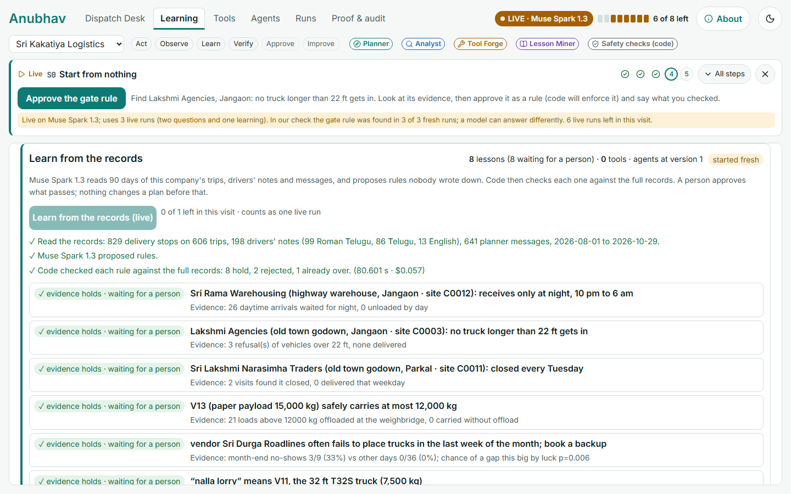
4. In the lesson list below, open the gate lesson, press **Approve as a rule…**, type *"Checked the evidence: three trucks over 22 ft were turned back at this gate."*, confirm. It shows **Active rule**.

   📷 Screen 3.2: the gate lesson approved

   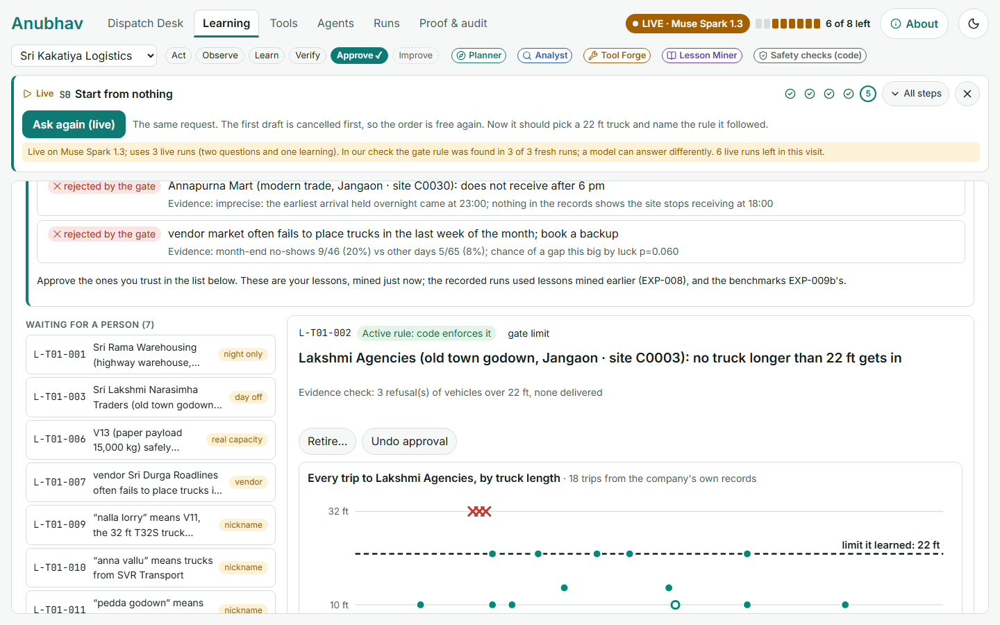

**Voice-over (≈ 60 words):**
> "Now it learns. Muse Spark 1.3 reads ninety days of this company's trips and drivers' notes, in Telugu and English, and proposes rules nobody wrote down.
> Code checks every one against the full records. A habit that only looks like a rule is rejected. A road closure that's over is stored as expired.
> This one holds: three long trucks turned back. I approve it."

**Notes:**
- Say "code checks", never "the AI checks": the gate is plain code.
- If the gate rule is missing in a take (it was found in every fresh run on Nov 3), re-take; the visit allows one learning run, so open a new browser profile (a new visitor).
- The model call takes 50–80 s; cut the wait in editing.
- The header then reads "8 lessons (8 waiting for a person)": rejected and expired ones are kept for the record but not counted as knowledge.

---

## 4. Same question, right (1:05 – 1:20) · DRAFT for the owner

**On screen, in order (live):**
1. Back to the Dispatch Desk. The guide's step is **Ask again (live)**; press it (same Telugu line, same model). It first cancels the 32 ft draft (kept in the audit), so the order is free to plan again.
2. The plan card: **22 ft · V08 · T22**, **✓ Fits the learned gate rule: Lakshmi Agencies, Jangaon (site C0003)**, "The gate takes at most 22 ft: lesson L-T01-002, learned from 3 turned-back trucks", the same three ✓ code checks, **Lessons it used: max 22 ft (L-T01-002)**. The guide says **All 5 steps done. Same model, same question. The only difference is one rule it learned from the company's records just now, checked by code and approved by you.** Hold 3 s.

   📷 Screen 4.1: the same question, now 22 ft

   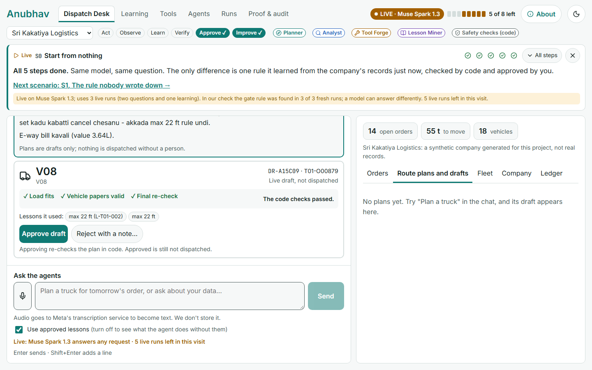
3. Optional, if time allows: the earlier recorded comparison, both trucks on one scale.

   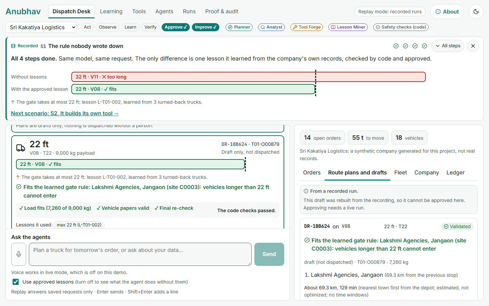

**Voice-over (≈ 40 words):**
> "Same model. Same question. Now it picks a 22-foot truck, and it says which rule it followed.
> It's still only a draft. Nothing is dispatched until a person approves it, and approving checks the plan in code again."

---

## 5. Roads change: Kazipet (1:20 – 1:35) · DRAFT for the owner

**On screen:** Learning → the expired lesson **L-T01-011, Kazipet: bridge closed (from 2026-08-01 to 2026-09-29)** (or scenario S6). The weekly chart: **45 closure delays, all inside the closure, none after it**, the ▼ marks for drivers' notes, **0 after it ended**. Scroll to **What drivers wrote on the delayed trips**: *"aa bridge pani jarugutundi detour"*.

📷 Screen 5.1: the Kazipet road story

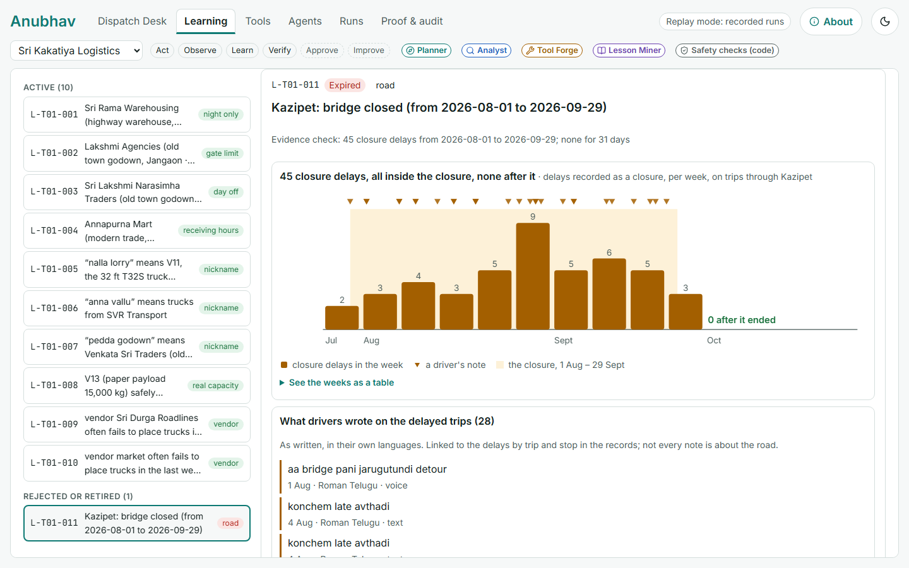

**Voice-over (≈ 36 words):**
> "Route knowledge comes from drivers, in their own words. A bridge at Kazipet closed for two months. No system recorded it; the drivers did.
> And when the road reopened, the lesson expired. It doesn't steer plans anymore."

**Note:** the subtitle for the note: *"bridge work is going on, detour"*.

---

## 6. The team (1:35 – 2:05) · DRAFT for the owner

**On screen, in order (recorded, free):**
1. Runs → **Busiest weekday, as a team**: the Person asks in Telugu; the **Planner** lane hands off (`delegate`) to the **Tool Forge** lane, which writes read-only SQL and gets the answer. Click the last step to show the SQL and "Answer it got". *(Recorded on Muse Spark Open.)*

   📷 Screen 6.1: one lane per agent, the hand-off

   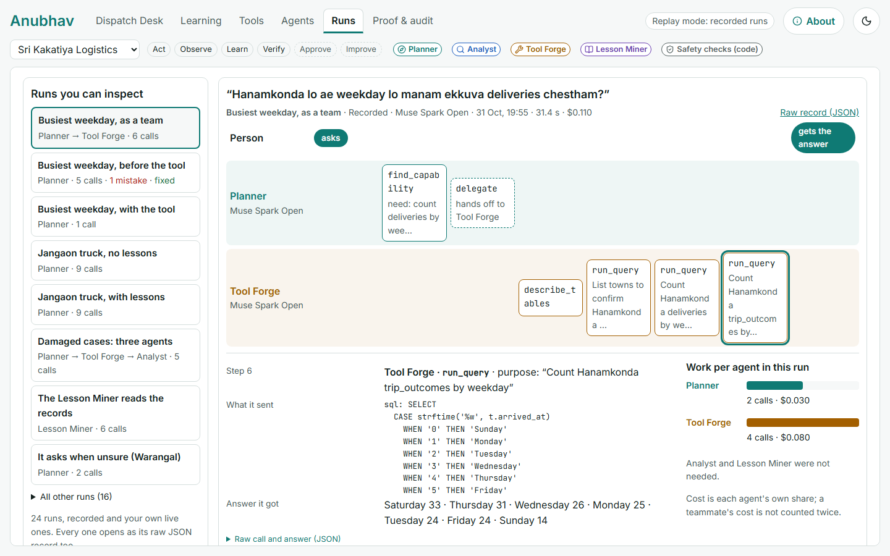
2. Click **Busiest weekday, before the tool**: 5 calls, **1 mistake · fixed** (the agent read its own SQL error and corrected it). Then **Busiest weekday, with the tool**: 1 call.
3. Tools tab: **A tool for questions like "Hanamkonda lo ae weekday lo…"**, *asked 4 times; it becomes a candidate tool at 3*. Press **Check this query**: code runs it on the original questions and on values it never saw; only then can a person approve it.

   📷 Screen 6.2: a repeated query that became a tool

   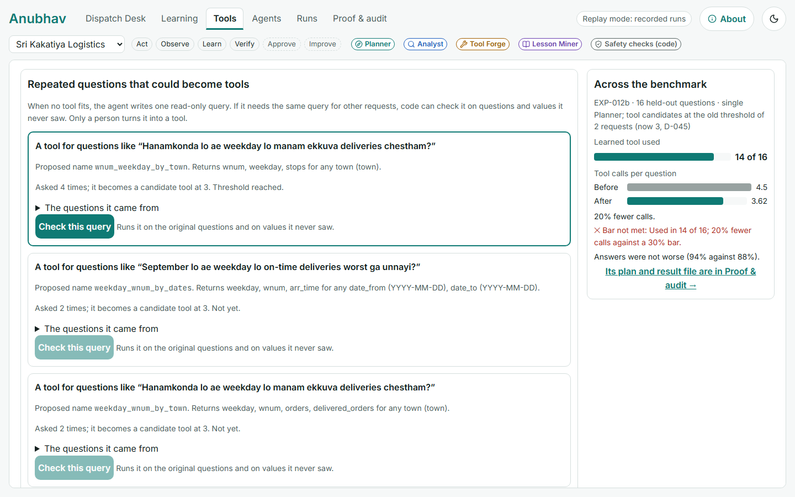

**Voice-over (≈ 62 words):**
> "It's a team. The Planner talks to you and hands work to the others. Here it passes a data question to Tool Forge, which writes a read-only query.
> Agents read their own errors and fix them; this one corrected its SQL.
> And work they keep repeating becomes a tool. Code checks it gives the same answers, and a person approves it. Five calls become one."

**Notes:**
- These runs are recorded on Muse Spark Open; the screen says so. Never say the live model builds tools (EXP-016: on Spark 1.3 none was made).
- Never say the team is more accurate than one Planner (EXP-013 says it isn't; it is safer and picks the right agent more often).

---

## 7. Proof, failures included (2:05 – 2:35) · DRAFT for the owner

**On screen, in order (recorded, free):**
1. Proof & audit → **Check our claims**: **Measured on both models**: unwritten rules **48% → 90%** (Muse Spark Open) and **45% → 90%** (Muse Spark 1.3); new company on day 1 **33% → 100%** on both; **0** unsafe drafts with lessons; **3 of 3** repeats met both bars. Hold 3 s.

   📷 Screen 7.1: measured on both models

   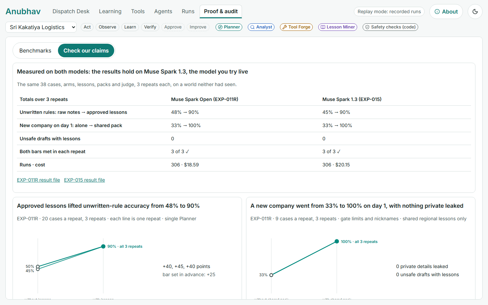
2. **Benchmarks**: the world it had never seen (T01 21/42 → 36/42, unsafe 2 → 0), then scroll the scoreboard of 20 pre-registered experiments; pause on a red ✕.

   📷 Screen 7.2: Benchmarks

   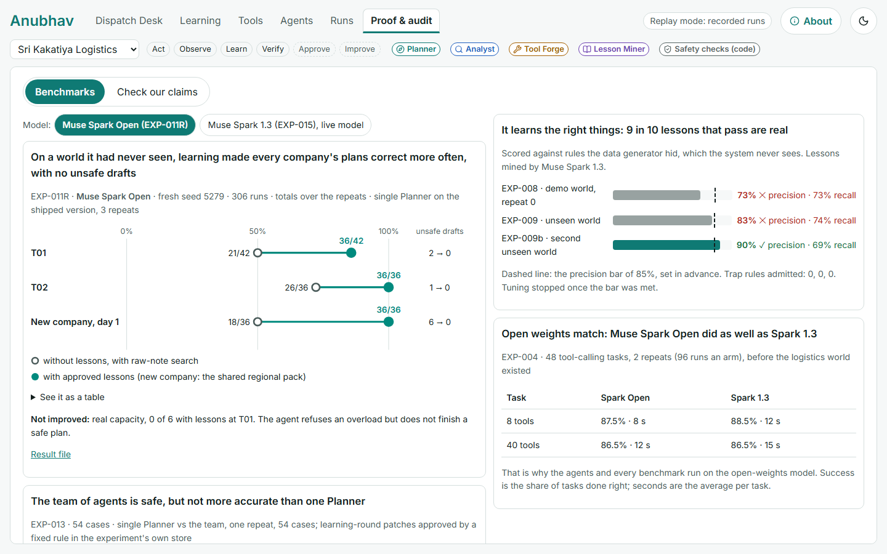
3. **Agents**: each agent's card, how it learns, what was measured. Point at Tool Forge's red line: **EXP-014: 100% → 50% after its approved change**.

   📷 Screen 7.3: Agents, measured, failures in red

   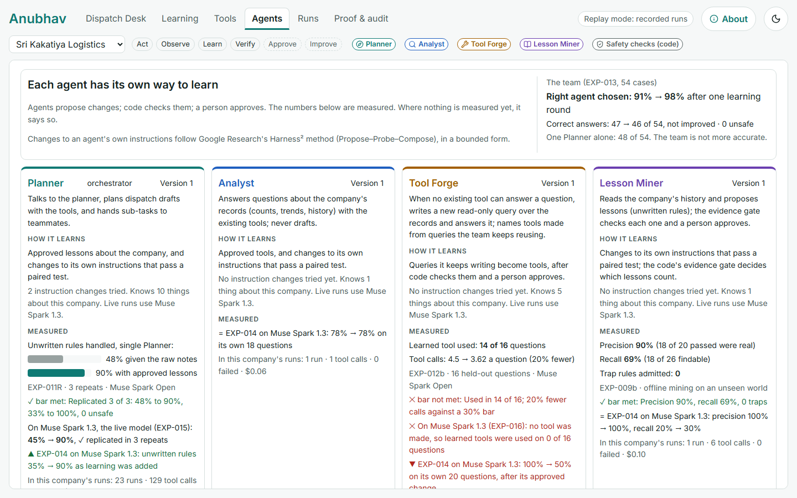

**Voice-over (≈ 62 words):**
> "Does it hold up? Every experiment was written down and committed before it ran.
> With approved lessons, plans on unwritten rules went from under half right to ninety percent, on both Muse models, with no unsafe drafts.
> And what didn't work is here too. One agent's own approved change made it worse. That's on the scoreboard, in red."

**Notes:**
- "Under half right" covers 48% and 45%. EXP-014's team curve (58.6% → 91.4%, unsafe 4 → 0) is on the Agents tab if a viewer looks; don't add more numbers aloud.
- Don't say it "undoes" a bad change on screen: a rollback exists in the code (the instruction versions), but no screen offers it.

---

## 8. Close (2:35 – 2:50) · DRAFT for the owner

**On screen:** the hosted app's first screen with **S0 Start from nothing** first among the scenarios, then the GitHub repo page. *(📸 to capture after the Space is live.)*

📷 Screen 8.1: the first screen (from the fresh run)

**Voice-over (≈ 36 words):**
> "Anubhav means experience. Same model, verified experience, safer plans.
> Built on Muse Spark Open, Muse Spark 1.3 and Muse Voice Transcribe. Try it yourself: start from nothing, and watch it learn."

**Note:** on the hosted app, live runs need the Meta key on the Space; without it, the recorded scenarios still play (say "try it" only once the Space is live).

---

## Recording notes
- Restart the machine first (memory was low on Nov 3); close other apps; browser zoom fixed; notifications off.
- Record each section as its own take; join them in editing. Telugu lines get English subtitles.
- Keep 2–3 takes of the live sections (2, 4) in case the model answers differently.

## Appendix: intro options considered (Nov 3)
**The message:** a self-improving system with self-improving agents, said so the evidence backs every word: the agents improve themselves from their own work; code tests every change; a person approves; only what helps is kept, and what didn't help is shown. Never "every agent gets better" (EXP-014: Tool Forge's own change made it worse).

- **A (chosen):** problem first, then the self-improving system (above).
- **B: self-improving, safely:** "Anubhav is a team of AI agents that improves itself. They learn the business's unwritten rules from its own records, turn repeated work into tools, and change their own instructions. Code tests every change. A person approves it. Only what helps is kept." *(Its trust line moves to section 7.)*
- **C: the name, then the system:** "Anubhav means experience. It's a self-improving team of AI agents for small truck fleets, where the rules aren't written down. The agents learn them from the company's records and improve their own work, and nothing changes without a check and a person."

**Facts used (all checked):** EXP-014, the team 58.6% → 91.4% as learning was added, unsafe drafts 4 → 0 (Muse Spark 1.3); EXP-015, the main result replicated on both models; EXP-013, the right agent chosen 91% → 98%; the Planner 35% → 90% on unwritten rules with its lessons; EXP-014, Tool Forge 100% → 50% (shown as a failure). The 22 ft gate at Lakshmi Agencies, Jangaon, is in the demo records and was found in 3 of 3 fresh mining runs (phase A, Nov 3). "Three in four … fewer than five trucks" is Redseer, Dec 2024. *Anubhav* (అనుభవం) means "experience". All companies and records are synthetic, which the app says.
