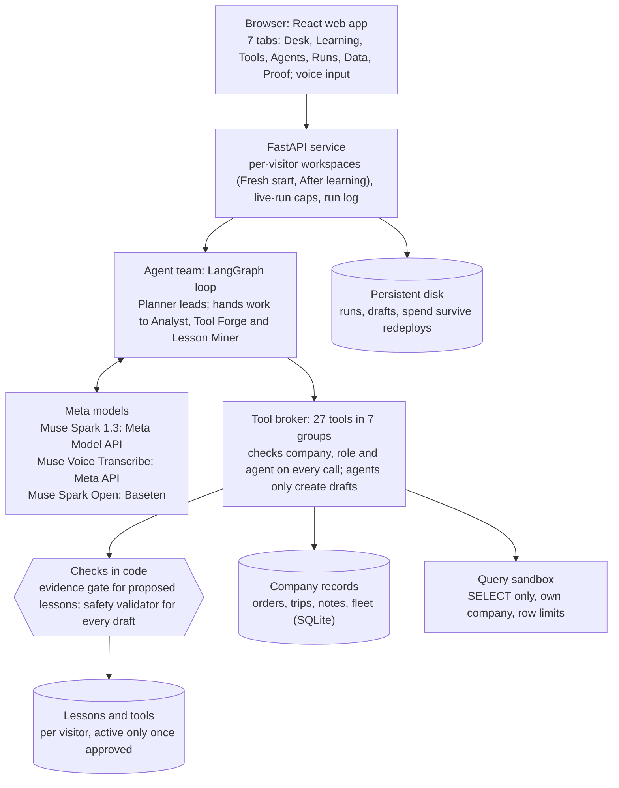
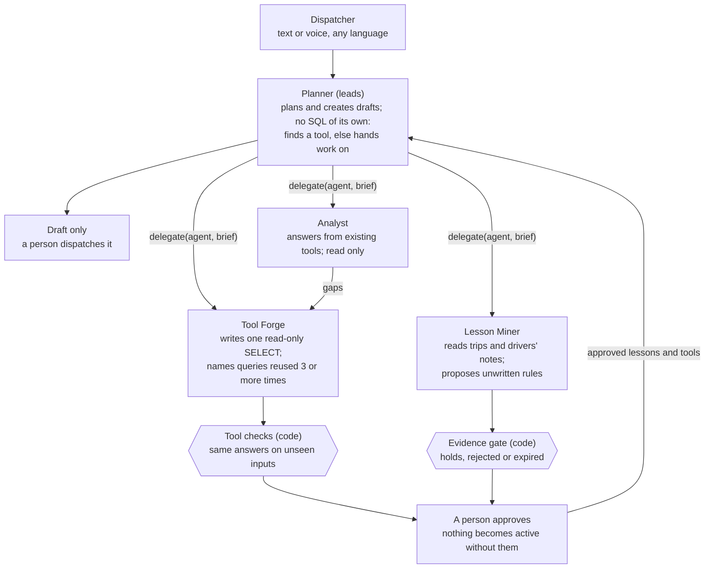
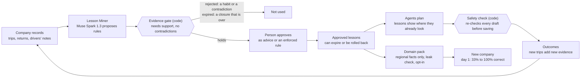

# Anubhav: Hackathon Project Guide

*As of Nov 5, 2026 · Katakam Prashanth*

## At a glance

Anubhav is a team of AI agents on Meta Muse that learns the rules a business never wrote down, from its own records, and plans better because of it. Code checks every rule against the evidence and a person approves it before any agent uses it.

| | |
| --- | --- |
| Hackathon | [Meta Global AI Developer Hackathon](https://cerebralvalley.ai/e/meta-ai-developer-hackathon/details) (Meta and Cerebral Valley), remote, Oct 26 to Nov 4, 2026 |
| Track | Indie Developer, solo entry |
| Problem statement | Push the Frontier: give a machine a new capability in the real world |
| Builder | Katakam Prashanth ([prashanth-ds-ml](https://github.com/prashanth-ds-ml)), AI engineer, Hyderabad |
| Submission deadline | Nov 4, 2026, 9:00 PM ET (Nov 5, 7:30 AM IST) |
| Judging | Nov 5 to Nov 8; closing ceremony and finals Nov 9; community vote Nov 16 |
| Live demo | [huggingface.co/spaces/KPrashanth/anubhav](https://huggingface.co/spaces/KPrashanth/anubhav) |
| Code | [github.com/prashanth-ds-ml/anubhav](https://github.com/prashanth-ds-ml/anubhav) (public, MIT) |
| Meta models | Muse Spark 1.3 and Muse Voice Transcribe (Meta Model API); Muse Spark Open (open weights, on Baseten) |
| Example company | Sri Kakatiya Logistics, 18 trucks in Warangal, Telangana (synthetic, grounded in public sources) |
| Headline result | With approved lessons, plans on unwritten rules went from under half right to 90%, on both Muse Spark Open (48% to 90%) and Muse Spark 1.3 (45% to 90%), with no unsafe drafts |

The name means "experience" in Telugu and Hindi: the same model, given verified experience, makes safer plans.

## Hackathon rules audit

Anubhav meets every rule in the [participant guide](https://cerebralvalley.ai/e/meta-ai-developer-hackathon/details).

| # | Rule (participant guide) | How Anubhav meets it | Status |
| --- | --- | --- | --- |
| 1 | Build towards a problem statement | Push the Frontier: agents gain a new capability, learning a business's unwritten rules from its records | Met |
| 2 | Incorporate Meta's models | Muse Spark 1.3 and Muse Voice Transcribe through Meta Model API; Muse Spark Open (open weights) through Baseten | Met |
| 3 | Open source: repository must be public | [github.com/prashanth-ds-ml/anubhav](https://github.com/prashanth-ds-ml/anubhav), public, MIT licence | Met |
| 4 | Team size: at most four, solo allowed | Solo entry in the Indie Developer track | Met |
| 5 | New work only, built during the event | First commit Oct 27, 01:50 IST (after the Oct 26 kickoff); every commit is by prashanth-ds-ml; README section "Built during the hackathon" | Met |
| 6 | Demo shows only what was built during the event | The video shows only Anubhav's own features; open-source libraries are listed as dependencies in [LICENSES_AND_ATTRIBUTION.md](../LICENSES_AND_ATTRIBUTION.md) | Met |
| 7 | No code, data or assets without rights | Data is synthetic; public sources shaped structure only and are credited with their licences (India Post, GODL-India; OpenStreetMap, ODbL; LaDe, Apache-2.0; Open Food Facts, ODbL) | Met |
| 8 | Avoid the sample anti-projects | Logistics planning: not medical advice, basic RAG, an image analyser, an education chatbot, or anything political | Met |
| 9 | Working live product | The Space is live; recorded scenarios are free, live runs are capped at 60 a day | Met |
| 10 | Three-minute demo video | Recorded under 3 minutes; ElevenLabs narration disclosed in the description | Met |
| 11 | Submit on the CV platform by Nov 4, 9:00 PM ET, with a public repo and video link | Submitted with the repo, video and Space links | Met |
| 12 | Claim Meta Model API credits by Nov 4 | $150 claimed; $50 kept back so judges can run it live | Met |

### Judging rubric, and where the evidence is

Stage one is pass or fail on fit to the theme and real use of Meta's models. Stage two scores 0 to 10 on four criteria; the top five per track go to a live final.

| Criterion (weight) | What judges ask | Anubhav's evidence |
| --- | --- | --- |
| Impact (30%) | Real-world potential; could people use it? | Small fleets plan on phone calls and memory; a gate rule missed turns trucks back. The same loop fits any business with unwritten rules |
| Use of Meta AI tooling (25%) | Beyond a basic integration? | Four Muse agents with enforced tool permissions, a model that proposes its own rules, voice input in Roman Telugu, and the result measured on both Muse Spark Open and Muse Spark 1.3 |
| Technical depth and execution (20%) | Sound, well thought-through engineering? | Evidence gate in code, 21 pre-registered experiments, per-visitor workspaces, spend caps, tests in pytest and Playwright |
| Demo (25%) | Working, impressive, holds up live? | A live Space anyone can use, with recorded scenarios that cost nothing |

Bonus prizes it can enter: Best Build on Meta Open Weight Models (Muse Spark Open ran every agent benchmark from EXP-005 to EXP-013), Best Agentic Use-Case, Community Vote, and Most Viral (posts on X after the event).

## The problem and the idea

A model can follow every written check and still plan wrong, because the rule that matters was never written down. Anubhav learns those rules from the company's own records, proves each one in code, and lets a person approve it.

**The problem.** Most Indian truck operators run small fleets and plan on phone calls and memory, in Telugu, Roman Telugu (Telugu typed in English letters) and English. The knowledge that keeps trucks moving sits in the dispatcher's head.

**The example.** Sri Kakatiya Logistics runs 18 trucks out of Warangal. Its dispatcher knows a 32-foot truck can't get into the Lakshmi Agencies godown in Jangaon. Three trucks were turned back before anyone wrote it down, and no software knows it.

**What a model does today.** Asked in Roman Telugu, *"Repu Jangaon Lakshmi Agencies load ki bandi pettu"* (arrange a truck for tomorrow's Jangaon load), Muse finds the order, the free trucks and the load, passes every written check, and picks a 32-foot truck. It looks right and isn't.

**What Anubhav adds.**

1. A Lesson Miner reads 90 days of trips and drivers' notes and proposes rules nobody wrote down.
2. An evidence gate in code tests each proposal against the records: a rule holds, is rejected as a habit, or is stored as expired.
3. A person approves the rule. Nothing reaches the agents unapproved.
4. The same model, asked the same question, now picks a 22-foot truck and names the rule it followed. It is still only a draft: nothing is dispatched until a person approves.

**Why it fits Push the Frontier.** The model gains a capability it lacked: turning a business's unrecorded experience into verified, reusable rules, measured before and after on the same model.

## System architecture

Every request flows from the browser through one API to the agent team, and every tool call the agents make passes one broker that enforces company, role and agent before it touches a record.

The stack is FastAPI and Python on the server, React and TypeScript in the browser, LangGraph for the bounded agent loop, SQLite for each company's records and each visitor's lessons, and a Hugging Face Space with a persistent disk for hosting. The same 27 tools are also served as an MCP server. Nothing in the runtime is hand-coded world knowledge: no word lists, site rules or spelling maps; the agents must learn them.

## The agentic system

Four Muse agents work as a team, and each can call only its own tools: the limits live in [`configs/agents.yaml`](../configs/agents.yaml) and the broker refuses any other call with "that is another agent's work (use delegate)". No agent can change the company's records: the Planner only drafts and the Lesson Miner only proposes.

| Agent | Can do | Cannot do | Example skill (SKILL.md) |
| --- | --- | --- | --- |
| Planner | Read orders, fleet, sites and history; create drafts; delegate | Write its own database queries | route-data-questions |
| Analyst | Answer from existing and learned tools, read only | Write queries, create drafts | hand-to-tool-forge |
| Tool Forge | Run one read-only SELECT over the records; name reused queries | Create drafts, delegate, propose lessons | repair-a-tool |
| Lesson Miner | Read a digest of the records; propose lessons | Create drafts, approve anything | revise-after-gate |

**A delegation, step by step: "Kazipet bridge pani inka jarugutunda?"** (is the Kazipet bridge work still going on?)

1. The Planner sees a question about the records, not a plan, and calls `find_capability`.
2. Existing tools might answer it, so it calls `delegate(analyst, brief)` with what to find and for which dates.
3. The Analyst checks trip outcomes through Kazipet with its own read-only tools.
4. The answer returns to the Planner: the rail overbridge closure ran Aug 1 to Sep 30, 2026, and is over.
5. The Planner replies in the dispatcher's language. If no tool could answer, the Analyst would have handed the brief to Tool Forge.

**Guard rails.** One budget covers a whole request, shared by every agent it reaches ($0.40, delegation depth at most 2). When a run must go past a limit it stops and asks a person: Approve, Decline, or Other. Before a reply reaches the dispatcher, code checks that every draft, vehicle and order id came from that run and that it never claims a dispatch.

**One agent or a team?** EXP-013 found one Planner as accurate as the team (48 of 54 against 47 of 54), at lower cost. The team adds visible hand-offs, tool creation and per-agent learning, not better answers, and the app says so.

## The learning loop

A model proposes rules, but code decides whether the records support them and a person decides whether they become active. On an unseen world the gate let through rules that were 90% correct, and let in no trap rules (EXP-009b).

**Three things it learns, each behind its own check.**

| What is learned | Proposed by | Checked by | Approved by |
| --- | --- | --- | --- |
| Lessons: site limits, nicknames, real truck capacities, closures | Lesson Miner | Evidence gate: support, contradictions, a Fisher test, habits are not rules | A person, as advice or an enforced rule |
| Tools: a repeated question becomes one call | Tool Forge, after a query serves 3 different requests | Code turns values into parameters and checks it on inputs it never saw | A person |
| Agent versions: better tool hints and guidelines | The harness loop | A paired old-versus-new test | A person |

**The harness loop, inspired by Google Research's [Harness²](https://arxiv.org/abs/2610.14224).**

1. Read the agents' runs, traces and feedback.
2. Propose one small text change: a tool hint or a guideline, never executable code.
3. Test old against new on held-out cases.
4. A person approves; the version is kept with a rollback.

It is honest about its limits: in EXP-010 the one patch was rightly rejected (no gain), and in EXP-014 a change that passed its paired test made Tool Forge worse, so the paired test is not yet a reliable guard.

**Sharing.** Only approved regional facts travel to another company, rewritten in its ids, with counts instead of evidence text and a leak check. The recipient opts in and can revoke.

## Meta models: what ran where, and why

Three Meta models do the work, and every result in the app is labelled with the model that produced it. The main result was measured on both Muse Spark models, so no conclusion rests on one.

| Role | Model | Access |
| --- | --- | --- |
| Agents in benchmarks EXP-005 to EXP-013, and every recorded run in the demo | Muse Spark Open (`muse-spark-open-1026`), open weights | Baseten |
| Agents in live mode, and experiments EXP-014 to EXP-019 | Muse Spark 1.3 | Meta Model API |
| Lesson Miner and harness proposer | Muse Spark 1.3 | Meta Model API |
| Spoken requests in Telugu and Roman Telugu | Muse Voice Transcribe | Meta Model API |

**Why the move between models.**

1. **Oct 27 to Oct 30.** An early check (EXP-004) found Muse Spark Open within a point of Muse Spark 1.3 on tool calling, and faster, so the agent benchmarks ran on it.
2. **Nov 1, the credit decision.** About $65 of the $100 Baseten credit had gone on benchmarks. The rest was kept for the hosted demo and judges (decision D-048), and my own runs moved to the Meta Model API (D-050).
3. **Nov 3 to Nov 4, the replication.** The main benchmark was repeated on Muse Spark 1.3 (EXP-015): 45% to 90% on unwritten rules and 33% to 100% for a new company, in 3 of 3 repeats.

**What differs between them.** Lessons and sharing work on both. Learned tools were made and reused only on Muse Spark Open: Muse Spark 1.3 answered the same questions well, but wrote each one as a different query, so no query repeated enough to become a tool.

**Credit plan.** Meta gave $150 of Model API credit; $50 is kept back so judges can run the demo live. Live runs are capped at 60 a day for the whole demo, 30 of them on Muse Spark Open.

## Experiments and results

Twenty-one experiments ran, each with its plan and pass bar written down (and frozen by hash) before the first model call. The main result held on both models: with approved lessons, unwritten-rule cases went from 48% to 90% on Muse Spark Open (EXP-011R) and from 45% to 90% on Muse Spark 1.3 (EXP-015), in 3 of 3 repeats, with no unsafe drafts. A new company went from 33% to 100% on day 1 using a shared regional pack.

**The team as it learns (EXP-014, Muse Spark 1.3 agents, 58 unseen test cases).** Each stage adds one kind of learning:

| Stage | Nothing learned | + approved lessons | + shared pack | + approved tools | + agent changes |
| --- | --- | --- | --- | --- | --- |
| Correct | 58.6% | 77.6% | 87.9% | 93.1% | 91.4% |
| Unsafe drafts | 4 | 2 | 0 | 0 | 0 |

The whole team gets better as lessons and shared packs are added. The "+ approved tools" step made no tools, so its rise is run-to-run variation, and the agent changes did not help.

### Every experiment

Met = the pre-registered bar was met; not met = it was missed and is reported as such; finding = an exploratory measurement with no bar.

| ID | Question | Model (agent) | Verdict | Result |
| --- | --- | --- | --- | --- |
| EXP-001 | Is there anything worth fixing in tool calling? | Spark 1.3 | finding | 88.5% with 8 tools: little headroom |
| EXP-002 | 40 tools: direct, or Muse's own tool search? | Spark 1.3 | finding | Tool search no better, and slower |
| EXP-003 | Does a business operations lab show something new? | Spark 1.3 | finding | Matched the optimum; dropped |
| EXP-004 | Muse Spark Open against Muse Spark 1.3 | both | finding | Within a point; Open faster |
| EXP-005 | Dispatch planning: where does the agent fail? | Open | finding | 0% on unwritten rules: became the problem |
| EXP-006 | Does it learn from history and transfer? | Open | met | Learning and transfer shown, 0 leaks |
| EXP-007 | Do gated lessons beat raw-history retrieval? | Open | not met | On small clean data, raw history did as well |
| EXP-008 | Learning at scale: what does mining find? | Open | not met | Mining precision 73% against an 85% bar |
| EXP-009 | Does a sharper gate reach 85% precision? | (mining only) | not met | 83%, 0 traps let in |
| EXP-009b | The same on a second unseen world | (mining only) | met | Precision 90%, recall 69%, 0 traps |
| EXP-010 | Does practice improve tool use? | Open | finding | Already 100%: the patch was rightly rejected |
| EXP-011 | Final benchmark on an unseen world | Open | met | 35% to 90%; new company 33% to 100% |
| EXP-011R | EXP-011 repeated 3 times on the shipped version | Open | met | 48% to 90%; 33% to 100%; 0 unsafe |
| EXP-012 | Do query tools and learned tools answer gap questions? | Open | not met | Learned tools never called (0/16) |
| EXP-012b | The same, with general tool names | Open | not met | Used on 14 of 16; 20% fewer calls, bar 30% |
| EXP-013 | Does the team work as well as one Planner? | Open | met | Safe, within bars, not more accurate |
| EXP-014 | Does the team improve as it learns? | Spark 1.3 | not met | 58.6% to 91.4%, unsafe 4 to 0; 3 of 5 bars |
| EXP-015 | Does EXP-011R hold on Muse Spark 1.3? | Spark 1.3 | met | 45% to 90%; 33% to 100%; 0 unsafe |
| EXP-016 | Are learned tools used on Muse Spark 1.3? | Spark 1.3 | not met | No tools made; answered well without |
| EXP-018 | Does learning improve with more history? | (mining only) | met | 30 to 60 days: recall 72.7% to 81.8%, precision 100% |
| EXP-019 | With Tool Forge writing all SQL, are tools made on 1.3? | Spark 1.3 | not met | Still no tools; 7.9 calls a question against 3.3 |

EXP-017 is a reserved number that never ran. Lesson mining used Muse Spark 1.3 throughout.

**Honest limits.** All data is synthetic and the benchmark cases come from the same generator as the hidden rules. Samples are small (20 cases behind the lessons result). Mining misses about 3 in 10 hidden rules. The team is not more accurate than one Planner.

**Where to find them.** In the app: Proof & audit. In this repository: [docs/trackers/experiments.md](trackers/experiments.md), [`artifacts/experiments_index.json`](../artifacts/experiments_index.json), and the README sections *How I got here* and *Results*.

## Data: synthetic, but grounded

Every company, record and rule is generated by Anubhav's own code, so lessons can be scored against hidden truth the system never sees. No real company's data is used, and no rows were copied from any public dataset: public sources shaped the structure and patterns only.

| Source | Licence | What it shaped |
| --- | --- | --- |
| India Post All India Pincode Directory | GODL-India (attribution) | Real Telangana towns, districts and PIN codes |
| OpenStreetMap | ODbL (attribution) | Road distances between towns |
| LaDe last-mile delivery dataset (Cainiao) | Apache-2.0 per its dataset card (research use) | Event order and timing gaps: loaded, departed, arrived, unloaded, delivered |
| Amazon Last Mile Routing Research Challenge | CC BY-NC 4.0 | Multi-stop trip shape, stop counts, package sizes |
| Open Food Facts | ODbL | FMCG pack sizes and weights |
| GST e-way bill rule | public rule | E-way bill needed above Rs 50,000 a consignment |
| Census 2011 town sizes | public | How many customer sites each town gets |
| Interview with a former FMCG logistics manager (Oct 27) | anonymised; no names or quotes published | The pain point: truck planning takes 1 to 1.5 hours a plan, up to about 10 re-plans a day in festival season |

**What the generator builds.** Four companies (Sri Kakatiya Logistics, Ramappa Carriers, Deccan Freight Services, and a new company, Bhadrakali Transport), each with trucks, drivers, customer sites, orders, trips, drivers' notes and outcomes. It plants 25 hidden rules (gate limits, site nicknames, real truck capacities, time windows, a temporary closure), plus traps: one-off events and contradicting notes that only look like rules. Seasonal effects include month-end peaks and a festival rush.

**Dates follow the real calendar.** On the hosted demo the history runs up to today, open orders start tomorrow and run five more days, and a world from an earlier day is generated again at start-up. The planted rules' dates all fall inside the history, so their evidence never changes.

Credits for the public sources are in [LICENSES_AND_ATTRIBUTION.md](../LICENSES_AND_ATTRIBUTION.md); the full specification is [docs/Data_Spec_v1.md](Data_Spec_v1.md).

## Hosted demo: how to try it

The demo runs at [huggingface.co/spaces/KPrashanth/anubhav](https://huggingface.co/spaces/KPrashanth/anubhav). Recorded scenarios replay real runs for free; live mode calls Muse for real. The first open after a quiet spell can take about a minute while the Space wakes up.

**The live story in five steps.**

1. Pick **Fresh start** (0 lessons, 0 tools) and the model **Muse Spark 1.3** in the header.
2. Ask by voice or text: *"Repu Jangaon Lakshmi Agencies load ki bandi pettu."* It drafts a 32-foot truck.
3. Open **Learning** and press **Learn from the records**. See which proposals the gate holds, rejects or marks expired.
4. Approve the Lakshmi Agencies 22 ft lesson as a rule.
5. Ask the same question again: it drafts a 22-foot truck and names the rule.

| Tab | What it shows |
| --- | --- |
| Dispatch Desk | Chat, scenarios S0 to S10, open orders by delivery day, fleet, drafts and plans |
| Learning | Lessons with their evidence, the gate's verdicts, approve or retire |
| Tools | Repeated questions that could become tools, their checks, approval |
| Agents | The four agents, their tools, skills and versions |
| Runs | Every run, with each tool call, cost and model |
| Data | The records the agents work on, with a date filter |
| Proof & audit | Claims checked against results, the scoreboard, all 21 experiments |

**Workspaces.** Each visitor gets two: **Fresh start** and **After learning** (seeded with the recorded lessons). Each keeps its own lessons, tools, drafts, runs and chat; switching never empties either, and **Reset** empties Fresh start only. Visitors never see each other's work, and state survives redeploys on the Space's persistent disk.

**Limits and safety.** Live runs are shared across visitors, up to 60 a day (30 on Muse Spark Open); learning from the records can run 5 times a visit. Agents only ever create drafts: nothing is dispatched. When a run needs to pass a limit it stops and asks: Approve, Decline, or Other.

## Repository map

| Path | What is there |
| --- | --- |
| `src/anubhav/api/` | FastAPI app and routes: sessions, runs, lessons, tools, data, the fresh-start workspaces |
| `src/anubhav/service/` | Per-visitor workspaces, spend caps, runs, proof and evidence views |
| `src/anubhav/agents/` | The team: agent registry, delegation, Tool Forge |
| `src/anubhav/agent/` | The bounded agent loop (LangGraph) |
| `src/anubhav/runtime/` | Company view, the broker for 27 tools in 7 groups, read-only query sandbox, safety validator |
| `src/anubhav/learning/` | Digest, Lesson Miner, evidence gate, lesson store, domain packs, learned tools |
| `src/anubhav/harness/` | Tool-use improvement loop: feedback, paired test, versions |
| `src/anubhav/data/` | The synthetic world generator, with hidden truth kept apart |
| `src/anubhav/eval/` | Benchmark case builder and judge |
| `src/anubhav/mcp_server.py` | The tools exposed as an MCP server |
| `configs/agents.yaml` | Each agent's model, purpose, instructions and allowed tools |
| `configs/skills/` | Each agent's skills, as SKILL.md files loaded on demand |
| `configs/world_v1.yaml` | Towns, companies, sites and the planted hidden rules |
| `web/` | React and TypeScript front end, with Playwright end-to-end tests |
| `scripts/` | The pre-registered experiments and the Space deploy script |
| `artifacts/` | Experiment results, logs and `experiments_index.json` |
| `demo/` | Recorded runs and lessons bundled for the hosted replay |
| `tests/` | pytest suites: data, runtime, learning, harness, safety, API |
| `docs/` | This guide, PRD, data spec, design notes, and the trackers for experiments, decisions and errors |
| `archive/` | First prototypes and experiments EXP-001 to EXP-006 (Oct 27 to 28) |

## Future scope: how it grows

Anubhav should get better with use, and the first check supports that: doubling a company's history from 30 to 60 days raised mining recall from 72.7% to 81.8% at 100% precision (EXP-018). Everything else below is a direction to measure, not a result.

**As it gets more data.** More trips give the evidence gate more to prove, so more hidden rules pass and fewer habits slip through.

**As it answers more questions.** Questions people repeat become tools: Tool Forge writes a read-only query, code checks it on inputs it never saw, and a person approves it. Then one call answers the question. Measured so far on Muse Spark Open only (14 of 16 questions used learned tools, EXP-012b).

**As the company and fleet grow.** Every new site, driver and truck adds evidence. A new company in the same region starts on day 1 with approved regional facts shared from others (33% to 100% in EXP-011R and EXP-015), with private details kept out by a leak check.

**As the organisation grows.** One Planner is as accurate as the team today (EXP-013). Separate duties, per-agent learning and permissions should matter more with more people, more data and write access: a hypothesis to test.

**Next steps.**

1. **Everyday changes approved by a person.** Agents propose new sites, orders or corrected addresses; code checks them, a person approves, and each write is audited.
2. **Permissions for writes.** The per-agent tool lists extend to changes: only the Planner proposes an order, the Analyst stays read-only.
3. **Learned tools on Muse Spark 1.3.** Show Tool Forge an earlier query for the same kind of question, or approve a query after 2 requests, each as a pre-registered experiment.
4. **Real fleets.** A real dispatcher reviews mined lessons, data from a working fleet, and regional packs across more companies.
5. **Any business with unwritten rules.** The loop (records in, rules checked by code, a person approves) is not tied to trucks. Clinics, warehouses and shops have the same kind of knowledge; each needs its own tools and evidence checks.

## Credits and AI use

**Ideas built on, reimplemented with no code copied.**

- [Harness²](https://arxiv.org/abs/2610.14224) (Google Research, *Recursive Agent Harnessing for an Open World*): the self-improvement loop follows its Propose–Probe–Compose idea in a bounded form, with small text patches, a paired old-versus-new test and human approval.
- Meta's legal-agent-workshop: client timeouts and retries, a clean stop when a model call fails, and checking a reply's claims in code.

**Open-source libraries** (FastAPI, React, LangGraph, pytest, Playwright and others) are used as dependencies only and listed in [LICENSES_AND_ATTRIBUTION.md](../LICENSES_AND_ATTRIBUTION.md).

**AI use, disclosed.** The code was written with an AI coding assistant, directed and reviewed by me; every commit is by prashanth-ds-ml. The demo narration is generated with ElevenLabs, and the Roman Telugu lines are spoken by me. All companies, people, sites, trucks and rules are fictional.
